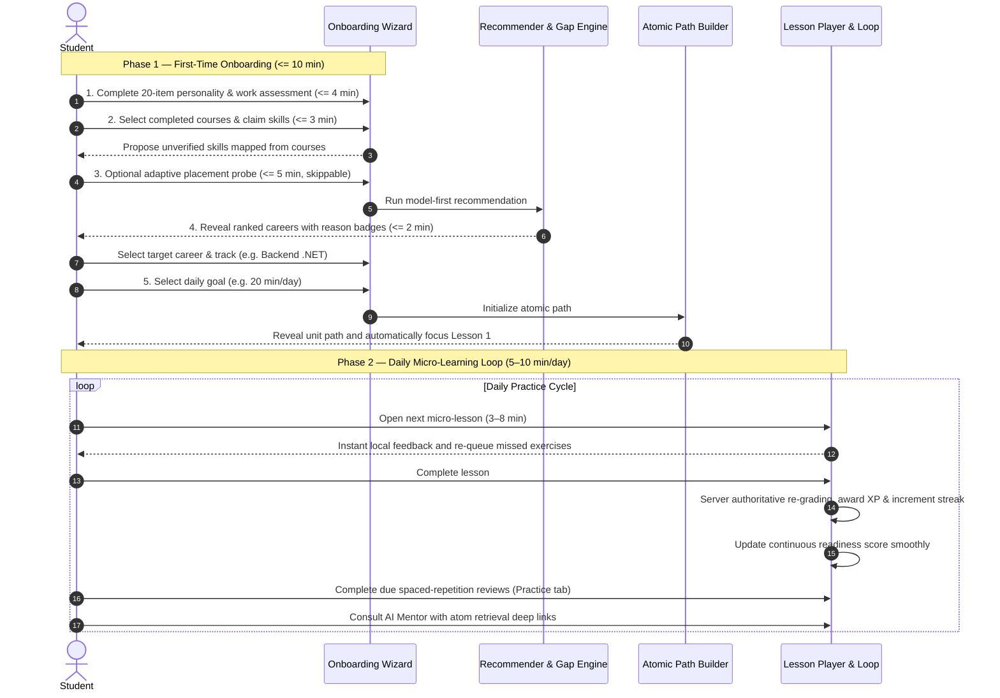

# 01 — Project Overview

**Document owner:** Abdelrahman Megahed · **Status:** Revised <2026-11-15> (atomic roadmap + defect fixes)

---

## 1. Project information

*(Atomic roadmap revision: 15 November 2026)*

| Field | Details |
|---|---|
| **Title (EN)** | Masar: An Intelligent Career Guidance and Skill-Gap Analysis System for Computer Science Students |
| **Title (AR)** | مسار: نظام ذكي للإرشاد المهني وتحليل الفجوات المهارية لطلاب علوم الحاسب |
| **Institution** | Suez Canal University — Faculty of Computers & Informatics |
| **Department** | Computer Science |
| **Supervisor** | Dr. Hend Shabaan |
| **Team size** | 8 |
| **Timeline** | 20 Sep 2026 → 20 May 2027 (35 weeks) |
| **Type** | Graduation Project |

---

## 2. Problem definition

A Computer Science student approaching graduation faces four distinct problems. They are
usually discussed as one vague problem ("students don't know what to do"), which is why
existing tools solve none of them well.

| # | Problem | Why existing options fail |
|---|---|---|
| P1 | **Choosing a specialization.** Backend, AI, data, security, cloud, frontend — a student cannot evaluate a path they have never worked in. | Career quizzes ask about personality, not technical skills, returning a label with no next step. |
| P2 | **Knowing which skills the market actually wants.** Job posts are inconsistent, and requirements drift faster than any curriculum. | Hand-written static roadmaps are undated, generic, and identical for every student regardless of what they know. The snapshot is dated; refreshing it is a documented procedure, not a runtime feature. |
| P3 | **Connecting university coursework to industry requirements.** A student who passed a databases course does not know that this already covers foundational SQL requirements. | No tool knows what the student's own department curriculum actually taught them. |
| P4 | **Turning a gap into a daily, atomic, trackable path.** Knowing you lack Docker does not tell you what to study first, how long it takes, or how to fit practice into 10 minutes a day. | Traditional platforms recommend 40-hour video courses; they do not break concepts into atomic micro-lessons with instant feedback, spaced review, and streak incentives. |

**The specific gap Masar addresses:** there is no system that takes a student's *actual*
skill state, compares it against *current* market requirements for a *specific* role, and
returns a *prerequisite-ordered, atomic learning path* of bite-sized lessons that adapts as the student learns.

---

## 3. Objectives and how each is delivered

Every objective maps to at least one feature and at least one requirement.

| # | Objective | Delivered by | Verified by |
|---|---|---|---|
| **O1** | Assess technical skills, interests and preferences | [Student Profile](05-features-mvp.md#51-student-profile), [Placement](05-features-mvp.md#52-placement-and-checkpoints) | FR-01…FR-06, FR-44 |
| **O2** | Recommend suitable career paths | [Career Recommendation](05-features-mvp.md#54-career-recommendation) | FR-10, [RQ1](09-evaluation.md#rq1) |
| **O3** | Analyse job requirements to identify demanded skills | [Job-Skill Extraction](06-ai-engines.md#2-engine-a--job-skill-extraction), [Curriculum Mapping](05-features-mvp.md#511-university-curriculum-mapping) | [RQ2](09-evaluation.md#rq2) |
| **O4** | Identify gaps against a target career | [Skill-Gap Analysis](05-features-mvp.md#55-skill-gap-analysis--core) | FR-12…FR-15 |
| **O5** | Generate personal atomic paths and project recommendations | [Atomic Roadmap](05-features-mvp.md#56-atomic-roadmap--core), [Projects](05-features-mvp.md#58-project-recommendations) | FR-37…FR-39, FR-21, [RQ3](09-evaluation.md#rq3) |
| **O6** | Track micro-lesson progress, derive mastery, and update readiness | [Lessons & Mastery](05-features-mvp.md#59-lessons-mastery-and-progress), [Readiness Score](05-features-mvp.md#57-career-readiness-score) | FR-40…FR-42, FR-26 |
| **O7** | Provide an AI-assisted mentor with atom retrieval | [AI Mentor](06-ai-engines.md#4-engine-c--context-aware-ai-mentor-rag) | FR-27…FR-29, FR-52, [RQ4](09-evaluation.md#rq4) |
| **O8** | Help students prepare for internships and entry-level roles | [Internship Readiness](05-features-mvp.md#512-internship-readiness-checklist) | FR-30, FR-53 |
| **O9** | Give faculty visibility into cohort-level skill and atom gaps | [Advisor Dashboard](05-features-mvp.md#513-advisor-dashboard) | FR-31…FR-33, FR-54 |
| **O10**| Keep learners practising daily (atomic lessons, streaks, review) | [Lesson Player](05-features-mvp.md#517-lesson-player), [Gamification](05-features-mvp.md#518-gamification), [Review](05-features-mvp.md#519-review-and-retention) | FR-40, FR-45, FR-46, [RQ5](09-evaluation.md#rq5), [RQ8](09-evaluation.md#rq8) |

---

## 4. Scope

### In scope (MVP)

- Career guidance for **6 technology career paths** ([§04 5.2](04-data-model.md#52-seed-careers)).
- **Computer Science students** at Suez Canal University as primary audience.
- **Atomic Roadmap of $\approx 4,050$ micro-lessons** (3–8 minutes each) grouped into structured units across four stages.
- **Interactive Lesson Player** with instant feedback and authoritative re-grading.
- **Gamification mechanics:** XP, daily goals, IANA timezone streaks, streak freezes, and exam pauses.
- **Spaced repetition practice queue** (Leitner 5-box system).
- **Static content delivery:** Pre-rendered versioned JSON bundles (`/content/v{n}/*.json`) served via CDN.
- **English UI**, with i18n-ready structure for future Arabic micro-lessons ([NFR-13](02-requirements.md#nfr-13--internationalisation-readiness)).
- **Responsive web application (PWA)** optimized for mobile and desktop browsers.
- **Frozen, documented snapshot** of 500–800 job postings ([ADR-0003](adr/0003-job-data-sourcing.md)).

### Explicitly out of scope

| Not doing | Why |
|---|---|
| In-browser code execution sandbox | High security/sandbox complexity, zero budget. Exercises use structured tokens, ordering, and bug identification. |
| Live scraping at scale | Legal and stability risks on free hosting. Uses a frozen snapshot. |
| Real job matching / vacancies | Out of scope; we match careers, not live vacancies. |
| Native mobile apps (iOS/Android) | Responsive PWA covers student devices at zero additional maintenance cost. |
| Payments, subscriptions, monetisation | $0 budget academic graduation project. No hearts/lives or paywalls. |
| Authored long-form video courses | Curates external deep-dive links (`ATOM_RESOURCE`) instead. |
| Multi-tenant university federation | Focuses strictly on Suez Canal University CS department. |

---

## 5. Expected contribution

Masar connects three things that are normally disconnected: **what a student can do**,
**what their university taught them**, and **what employers are asking for**.

Four contributions are genuinely defensible in a thesis:

1. **A model-first career recommendation method.** An AI recommendation pipeline combining profile embeddings, semantic scoring, and reranking, followed by deterministic mandatory constraints ([RQ1](09-evaluation.md#rq1)).
2. **Curriculum-to-atom mapping.** Mapping department course syllabi directly to learning atoms, pre-filling verified starting paths. We are not aware of a comparable academic or commercial system doing this at an atomic granularity; a formal literature check is scheduled ([12 §7](12-references.md#7-literature-check-schedule)).
3. **Atomic, prerequisite-aware roadmap.** A deterministic graph decomposed into $\approx 4,050$ atoms with an authored, validated canonical order, gap-driven unit prioritisation, and continuous derived mastery.
4. **Regional market weighting.** Skill importance computed from Egypt/MENA postings alongside global postings, highlighting local technology variances.

### Where AI sits, precisely

> **AI provides intelligence for career prediction, job-posting extraction, offline lesson drafting, and student mentoring. Deterministic logic strictly governs all core learning loops (gap analysis, atomic roadmap generation, mastery derivation, and streak tracking).**

| Concern | Owned by | Rationale |
|---|---|---|
| Job skill extraction from free text | **AI** (NLP, offline) | Unstructured text requires NLP and context disambiguation |
| Offline micro-lesson drafting | **AI** (Offline LLM, human review) | High volume requires AI drafting with automated CI checks |
| Career prediction / ranking | **AI recommendation service** | Semantic scoring and reranker provide primary match signal |
| Mandatory career constraints | **Deterministic logic** | Hard business rules must never be violated |
| Gap classification & priority | **Deterministic** | Monotone arithmetic provable by unit tests |
| Atomic path derivation & mastery | **Deterministic** | Pure functions over graph and student atom states |
| Explanation and mentoring | **AI** (RAG + Atom retrieval) | Natural language over allow-listed context and trusted atoms |

Every AI component has a documented non-AI fallback ([§06 7](06-ai-engines.md#7-fallbacks-and-graceful-degradation)).

---

## 6. Related work

Full citations in [§12](12-references.md).

| System | What it does | What it does not do |
|---|---|---|
| **roadmap.sh** | Excellent hand-curated role roadmaps | Identical for everyone; no assessment, no gap analysis, no atomic lessons or progress tracking |
| **Duolingo / Codecademy / boot.dev** | Gamified bite-sized learning paths with streaks | Generic curricula; not tied to university courses, market demand, or personalized gap analysis |
| **Khan Academy / ALEKS** | Knowledge tracing and adaptive practice | Academic school topics; no tech career alignment or job-posting demand weighting |
| **LinkedIn Skills / Learning** | Course suggestions from user skill graphs | Optimises for engagement; no prerequisite sequencing; commercial incentive |
| **Coursera / Udemy** | Video course libraries | Coarse 40-hour courses; no atomic daily micro-lessons; no cohort analytics |
| **O\*NET / ESCO** | Public occupation-skill taxonomies | Reference data, not a consumer product; slow-moving; no student learning path |

---

## 7. Team & responsibilities

| Member | Role | Primary responsibilities | Backs up |
|---|---|---|---|
| **Abdelrahman Megahed** | Team Lead · Full-Stack | Architecture, [API contract](07-api-contract.md), integration, security review, defence coordination | Floating capacity |
| **Mohamed Yasser** | .NET Backend | Data model & migrations, seed loaders, curriculum-to-atom mapping, profile services | Osama |
| **Osama Mohammed** | .NET Backend | **Path engine**, **mastery derivation**, **game state (XP/streak)**, lesson API | Mohamed Y. |
| **Ahmed Yousef** | AI / ML | Prompt templates for drafting, blind-solve checks, recommendation pipeline, mentor retrieval, [evaluation](09-evaluation.md) | Ziad |
| **Ziad Ahmed** | Frontend · Integration | Lesson player, path UI, result sheet, AI service client integration support | Mazen |
| **Mazen Oraby** | Frontend | Profile, onboarding, review player, dashboard views | Ziad |
| **Yousef Khaled** | UI/UX | Design tokens, accessible UI components, animations, usability testing | Mazen |
| **Mohamed Salah** | DevOps | Content factory CLI, CI validator, static bundle publishing, uptime ping, deployments | Abdelrahman |

---

## 8. The end-to-end user workflow

Masar operates on a two-phase user journey that resolves onboarding drop-off while driving daily micro-learning:

### 8.1 Phase 1 — Onboarding and path reveal

1. **Personality & preference assessment:** 20 Likert items ($\le 4$ minutes) establishing initial interest and work-style vectors.
2. **Coursework & skill identification:** Course mapping pre-fills unverified foundational skills; student claims additional skills ($\le 3$ minutes).
3. **Targeted adaptive placement probe:** Diagnostic up/down probe for core claimed skills (capped at level 4 verified; skippable).
4. **Career recommendation & target selection:** Model-first recommendation with inspectable reason badges. Student commits to target career and track ($\le 2$ minutes).
5. **Daily goal & path reveal:** Student selects daily study target (10, 20, 30, 45, or 60 min) and is launched directly into their first lesson ($\le 10$ minutes total without placement, $\le 15$ minutes with placement).

### 8.2 Phase 2 — Daily micro-learning loop

- **Micro-lessons (3–8 minutes):** Focus mode, structured exercises, instant local feedback.
- **Authoritative mastery:** Server re-grades attempts, derives band mastery $m_b$, updates integer level $L(s)$, and smoothly advances continuous readiness $c(s)$.
- **Gamified motivation:** XP rewards, daily streaks (IANA timezone bounded), streak freezes, and exam-week pauses keep students practising daily without coercive life-depletion mechanics.
- **Spaced repetition:** 5-box Leitner review queue scheduled at 1, 3, 7, 14, 30 days.

---

## 9. One-sentence definition

> **Masar** measures a Computer Science student's skills, recommends matching career paths, quantifies precise skill gaps against live market requirements, and guides the student along an **atomic, prerequisite-aware roadmap of 3–8 minute micro-lessons** with instant feedback, streaks, and continuous readiness tracking that adapts dynamically as they learn.

---

**Next:** [02 — Requirements](02-requirements.md)
