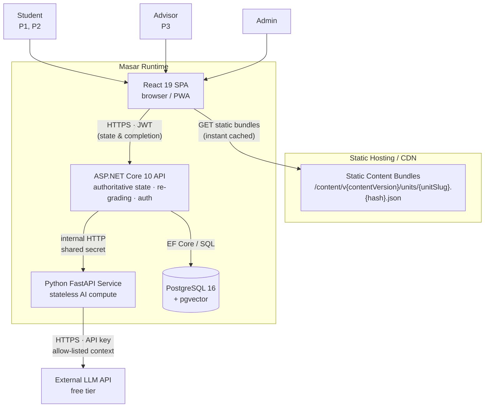
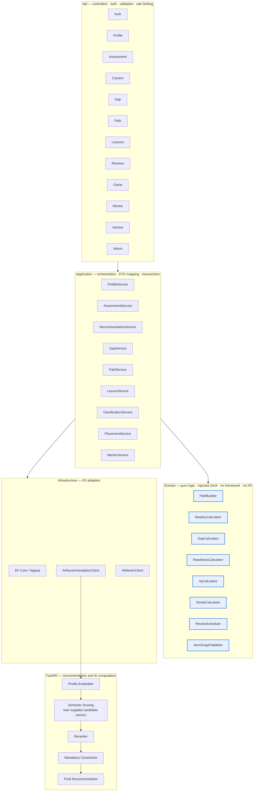
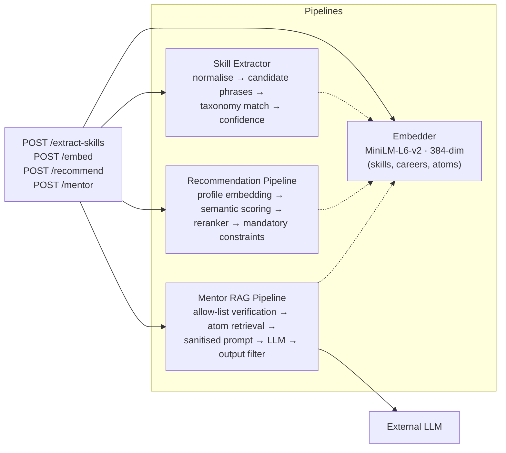
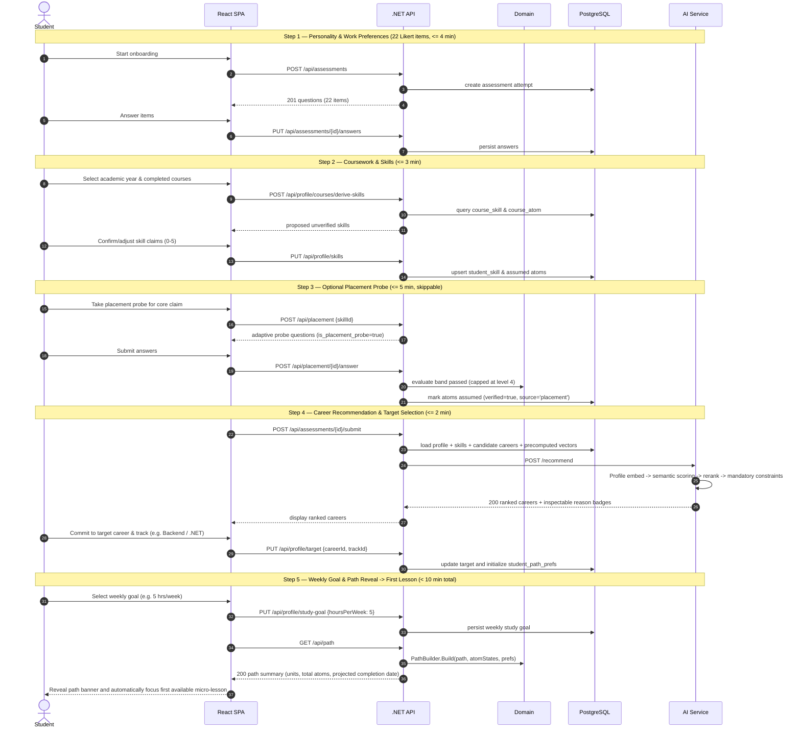
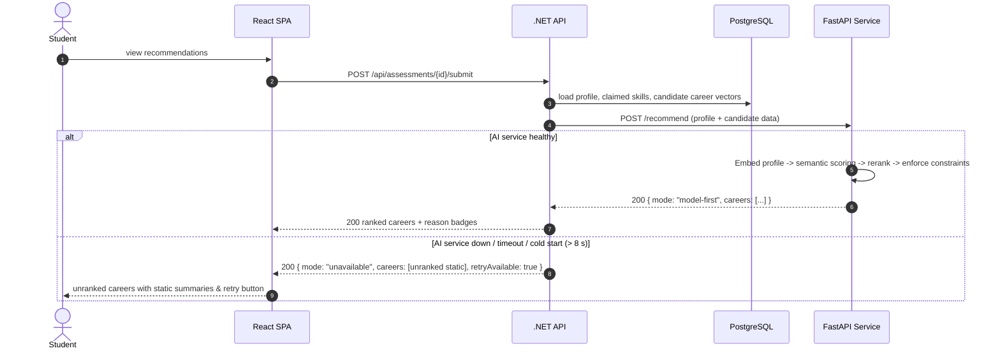
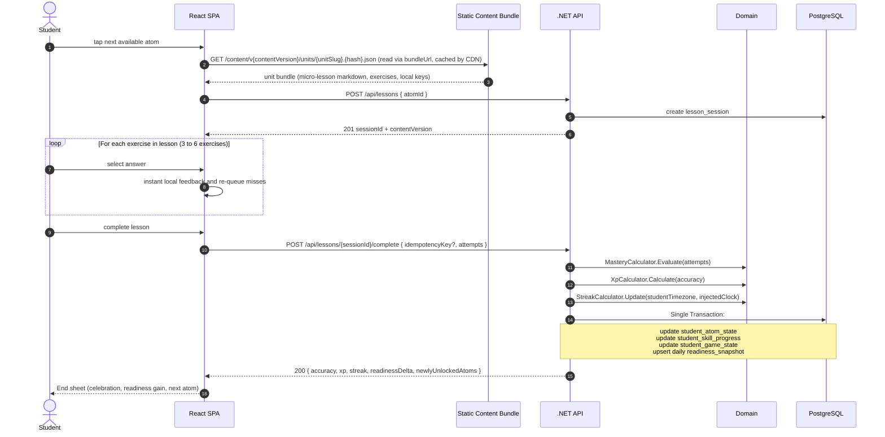
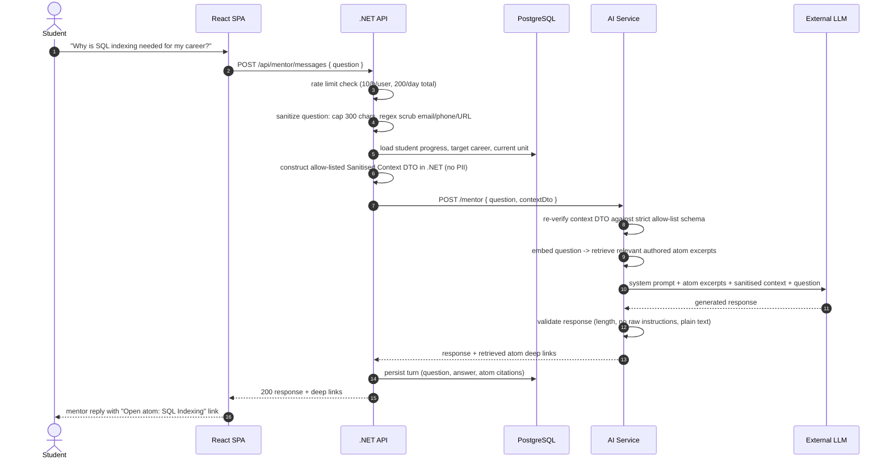
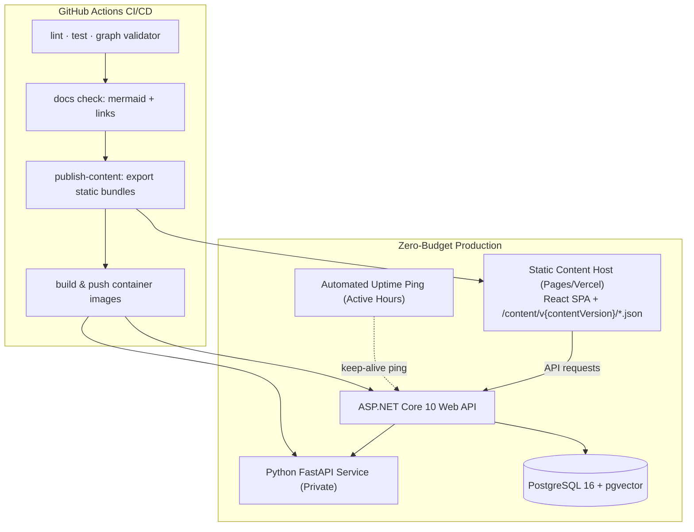

# 03 — Architecture

**Document owner:** Abdelrahman Megahed · **Status:** Revised <2026-11-15> (atomic roadmap + defect fixes)

---

## 1. Technology stack

| Layer | Choice | Why | Owner |
|---|---|---|---|
| Frontend | **React 19 + TypeScript + Vite** | Team's existing skill; TypeScript makes the [API contract](07-api-contract.md) enforceable at compile time | Ziad, Mazen |
| UI & Components | **Tailwind CSS + Radix UI primitives** | Radix provides accessible headless primitives ([NFR-05](02-requirements.md#nfr-05--accessibility)); consistent playful palette without trade-dress copying | Yousef K. |
| Client State & Caching | **TanStack Query v5** | Caches path summaries, manages optimistic updates, and queues offline lesson completions | Ziad |
| Path Virtualization | **TanStack Virtual** | Virtualizes vertical path rendering to current unit $\pm 2$, ensuring 60 FPS on mobile | Mazen |
| Motion & Animation | **Tailwind / CSS Transitions** | Lightweight micro-animations strictly respecting `prefers-reduced-motion` ([NFR-19](02-requirements.md#nfr-19--motion-and-sound-safety)); no heavy animation runtimes | Yousef K. |
| Static Content Delivery| **Static JSON Bundles on Cloudflare Pages / Vercel** | Delivers `/content/v{contentVersion}/units/{unitSlug}.{hash}.json` directly to the client; lessons start instantly even during API cold starts | Mohamed Salah |
| Backend | **ASP.NET Core 10 Web API (C#)** | Team's primary backend skill; active LTS release; high performance | Osama, Mohamed Y. |
| ORM | **EF Core 10 + Npgsql** | Migrations, type-safe queries, `Pgvector.EntityFrameworkCore` | Mohamed Y. |
| Database | **PostgreSQL 16 + pgvector** | Unified relational and vector store ([ADR-0001](adr/0001-database-and-vector-store.md)) | Mohamed Y. |
| AI Service | **Python 3.12 + FastAPI** | Embeddings, semantic scoring, reranking, and mentor RAG | Ahmed Y. |
| Embeddings | **sentence-transformers `all-MiniLM-L6-v2`** — 384 dimensions, ~23 M parameters, Apache-2.0 | Runs on CPU; precomputes catalogue and atom embeddings; peak RSS kept $\le 450$ MB | Ahmed Y. |
| LLM Provider | **Free-tier hosted API**, provider-abstracted ([ADR-0002](adr/0002-llm-provider.md)) | $0 budget; separate quotas for runtime mentor vs offline content drafting | Ahmed Y. |
| Content Factory Tooling | **Python CLI (`tools/content-factory/`)** | Offline CLI for LLM-assisted drafting and blind-solve checks; completely outside runtime | Mohamed Salah |
| Containers & CI/CD | **Docker + docker compose · GitHub Actions** | Local parity ([NFR-14](02-requirements.md#nfr-14--portability)) and automated CI verification | Mohamed Salah |
| Hosting & Uptime | Free tiers ([ADR-0005](adr/0005-zero-budget-hosting.md)) + scheduled keep-alive ping | $0 budget hosting with uptime ping during cohort active hours | Mohamed Salah |

---

## 2. Why three services and not one

The split is drawn on a **language and isolation boundary, not a scalability boundary**:

- **.NET owns all application state, public API endpoints, authoritative re-grading, and auth.** It is the only service that talks to PostgreSQL. It executes pure domain logic (`PathBuilder`, `MasteryCalculator`, `XpCalculator`, `StreakCalculator`), orchestrates student state transactions, and exposes system status endpoints (`GET /api/health`, `GET /api/ready`, `GET /api/meta`).
- **FastAPI owns stateless AI compute.** It performs profile embedding, semantic scoring, reranker scoring, mandatory constraint checks, and mentor RAG with atom retrieval. It maintains zero state and has no database connection.
- **Static Content Host serves pre-rendered unit content bundles.** Micro-lesson text, exercise definitions, and answer payloads are published as versioned static JSON files (`/content/v{contentVersion}/units/{unitSlug}.{hash}.json`). The React SPA fetches content directly from the CDN/static host, providing instant lesson starts even if the backend is cold-starting.
- **React owns presentation and instant client-side feedback.** The SPA checks exercise answers locally for instantaneous feedback, while submitting student selections to .NET for authoritative server-side grading upon lesson completion.
- **Content factory tooling is strictly offline.** The Python content factory (`tools/content-factory/`) used for LLM drafting and CI verification operates offline using a separate developer API key and quota; it is never in the runtime path.

---

## 3. System context

---

## 4. Backend internals

Key rules:

- **`Domain` references nothing.** All calculators are pure functions accepting plain arguments and an injected `IClock`.
- **Query budget:** Gap analysis executes in $\le 2$ queries; lesson completion executes in $\le 8$ queries within a single database transaction.

---

## 5. AI service internals

---

## 6. Service-to-service authentication

| Control | Implementation |
|---|---|
| Network | AI service bound to private container network; not publicly routable. |
| Shared secret | Every internal request carries `X-Masar-Service-Key` compared in constant time; returns `401` on mismatch. |
| Timeouts & Retries | Connect timeout: 2 s. `/recommend`: 8 s total timeout, 1 retry with exponential backoff. `/mentor`: 12 s total timeout, **no retry** (prevents doubling quota usage). |
| Failure handling | If `/recommend` fails or times out, .NET falls back to `mode: "unavailable"` with unranked career summaries and cached historical results ([F-24](10-risks-and-assumptions.md)). If `/mentor` times out, .NET returns a stored explanation. |
| Correlation | `X-Correlation-Id` propagated across all service boundaries. |

---

## 7. Key request flows

### 7.0 End-to-end onboarding and path reveal flow

### 7.1 Career recommendation — model-first with a FastAPI fallback

### 7.2 Path and lesson flow — static content with authoritative re-grading

**Pure Reads:** `GET /api/gap-analysis` and `GET /api/path` are strictly pure reads with no database side effects. Readiness snapshots are written only during state-mutating actions (lesson completion, target change), capped at one per profile, career, and local calendar day (F-18).

### 7.3 AI mentor — privacy-bounded RAG with atom retrieval

---

## 8. Deployment topology

---

## 9. Environments and configuration

| Setting | Local Development | Staging | Production |
|---|---|---|---|
| Database | `pgvector/pgvector` container | Free managed Postgres | Free managed Postgres |
| Static Bundles | Local Vite dev server | Static preview URL | Global Static CDN |
| LLM Provider | Mock by default; real key if supplied | Real free tier | Real free tier |
| Embeddings | Local CPU (`all-MiniLM-L6-v2`) | Real CPU | Real CPU |
| Seed Data | Full, resettable via CLI | Full, resettable | Seeded once, versioned |
| Demo Mode | Supported (`MASAR_DEMO_MODE=true`) | Supported | **Supported** |
| Log Level | Debug | Information | Warning |

---

## 10. Demo mode

When `MASAR_DEMO_MODE=true`:

- Pre-seeded student account (Omar) loads with known skills, active streak, and preset unit bundle fixtures.
- The AI service serves canned responses; zero external network requests are made.
- Placement probes and mentor questions return deterministic recorded responses.
- The demo operates completely offline, eliminating risk from host cold starts or third-party outages.

---

## 11. What we are deliberately not building

| Not building | Why | What we do instead |
|---|---|---|
| In-browser code execution sandbox | Security risk, high complexity, out of scope | Non-executing structured code exercises (token ordering, bug spotting, output prediction) |
| Real-time multiplayer leagues | Excessive complexity, network overhead | Async weekly leagues (opt-in, nickname-only, XP-based) |
| Native mobile applications | Multi-platform maintenance overhead | Responsive, mobile-first PWA with cached static bundles |
| Message queue / broker | Purely synchronous student flows | Synchronous, bounded endpoints with idempotent retries |
| Distributed Redis cache | Scale is 500 students; static bundles offload API | In-memory cache + static CDN caching |
| Microservices | Overkill for 8-person graduation team | Three clean services on a strict language boundary |
| Kubernetes | Costly and unneeded at this scale | Docker compose locally; platform containers remotely |

---

**Next:** [04 — Data Model](04-data-model.md)
