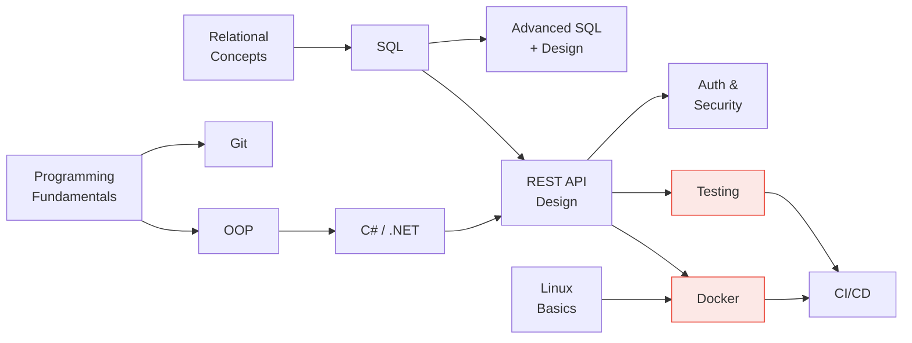

# 04 — Data Model

**Document owners:** Mohamed Yasser, Osama Mohammed · **Status:** Revised <2026-11-15> (atomic roadmap + defect fixes)

This document defines the vocabulary the entire system computes on. Get it wrong and every
downstream feature inherits the error, so it is worth more argument than any UI decision.

---

## 1. Design decisions that matter

Six choices here differ from the original specification. Each fixes a defect that would have
produced visibly wrong output in the demo or defence.

| # | Decision | Problem it fixes |
|---|---|---|
| D1 | Proficiency is an **integer 0–5 with written definitions**, not a percentage | "SQL 55 %" implies a precision self-assessment cannot deliver, and invites meaningless arithmetic. A student can pick between six described levels; nobody can honestly pick between 55 % and 60 %. |
| D2 | A career has **tracks**, and requirements can be **OR-groups** | The original example required "Python 90 %" for Backend Development. A .NET student would be told they have a Python gap, which is wrong and would embarrass the demo in front of a .NET-literate committee. |
| D3 | Skills have **canonical names plus aliases** | Job postings say "Postgres", "PostgreSQL", "psql", "Postgre SQL". Without aliases, extraction produces four skills where there is one. |
| D4 | Prerequisites are a **graph with enforced acyclicity**, stored separately from careers | Ordering is a property of the skill domain, not of a career. Sharing one graph means authoring it once instead of six times. |
| D5 | Mastery is **derived from atomic learning units** (`STUDENT_SKILL_PROGRESS`), not student-entered skill levels | Solves F-10: progress on resources/lessons previously could never update gap or readiness once a skill was calibrated. Progress now updates atom states (`learned`, `shaky`), deriving integer level $L(s)$ for gap analysis and fractional continuous level $c(s)$ for smooth readiness feedback. |
| D6 | Atomic roadmap uses **authored canonical ordering with CI validation**, availability derived from prerequisites | Retires 40-hour phase packing and runtime schedule instability. Units and atoms follow curated pedagogical order, while student path state derives available, locked, and completed nodes deterministically without mutating the master path. |

---

## 2. Entity-relationship diagram

```mermaid
erDiagram
    USER ||--o| STUDENT_PROFILE : has
    USER ||--o{ REFRESH_TOKEN : owns
    STUDENT_PROFILE ||--o| STUDENT_GAME_STATE : tracks
    STUDENT_PROFILE ||--o{ STUDENT_SKILL : claims
    STUDENT_PROFILE ||--o{ STUDENT_SKILL_PROGRESS : achieves
    STUDENT_PROFILE ||--o{ STUDENT_ATOM_STATE : learns
    STUDENT_PROFILE ||--o{ STUDENT_COURSE : completed
    STUDENT_PROFILE ||--o{ STUDENT_INTEREST : selected
    STUDENT_PROFILE ||--o{ ASSESSMENT_ATTEMPT : takes
    STUDENT_PROFILE ||--o{ LESSON_SESSION : plays
    STUDENT_PROFILE ||--o{ READINESS_SNAPSHOT : accrues
    STUDENT_PROFILE ||--o{ MENTOR_MESSAGE : exchanges
    STUDENT_PROFILE ||--o{ STUDENT_PORTFOLIO_ITEM : builds
    STUDENT_PROFILE ||--o{ DAILY_ACTIVITY : records
    STUDENT_PROFILE ||--o{ XP_EVENT : earns
    STUDENT_PROFILE }o--o| CAREER : targets

    SKILL ||--o{ SKILL_ALIAS : "known as"
    SKILL ||--o{ SKILL_RELATION : relates_to
    SKILL ||--o{ STUDENT_SKILL : rated_in
    SKILL ||--o{ STUDENT_SKILL_PROGRESS : summarizes
    SKILL ||--o{ SKILL_PREREQUISITE : requires
    SKILL ||--o{ CAREER_SKILL_REQUIREMENT : required_by
    SKILL ||--o{ COURSE_SKILL : covered_by
    SKILL ||--o{ ATOM : groups
    SKILL ||--o{ JOB_POSTING_SKILL : demanded_in
    SKILL ||--o| SKILL_EMBEDDING : embedded_as

    CAREER ||--o{ CAREER_TRACK : offers
    CAREER_TRACK ||--o{ CAREER_SKILL_REQUIREMENT : specifies
    CAREER ||--o{ REQUIREMENT_GROUP : groups
    CAREER ||--o| CAREER_EMBEDDING : embedded_as
    CAREER ||--o{ INTERNSHIP_CRITERION : defines
    CAREER ||--o{ PATH : provides

    REQUIREMENT_GROUP ||--o{ CAREER_SKILL_REQUIREMENT : contains

    STAGE ||--o{ UNIT : contains
    PATH ||--o{ PATH_UNIT : sequences
    UNIT ||--o{ PATH_UNIT : placed_in
    UNIT ||--o{ ATOM : contains

    ATOM ||--o{ EXERCISE : tests
    ATOM ||--o{ ATOM_PREREQUISITE : requires
    ATOM ||--o{ ATOM_RESOURCE : deep_dives
    ATOM ||--o{ STUDENT_ATOM_STATE : tracked_by
    ATOM ||--o{ COURSE_ATOM : maps_from

    LESSON_SESSION ||--o{ EXERCISE_ATTEMPT : records
    LESSON_SESSION }o--o| ATOM : plays_atom

    COURSE ||--o{ COURSE_SKILL : covers
    COURSE ||--o{ COURSE_ATOM : covers_atoms
    COURSE ||--o{ STUDENT_COURSE : taken_by

    ASSESSMENT_ATTEMPT ||--o{ ASSESSMENT_ANSWER : records
    ASSESSMENT_QUESTION ||--o{ ASSESSMENT_ANSWER : answers

    JOB_POSTING ||--o{ JOB_POSTING_SKILL : mentions
    JOB_POSTING }o--o| CAREER : classified_as
```



---

## 3. The proficiency scale

One scale, used everywhere: student levels, career requirements, resource levels, and atom bands.
Mixing scales is how gap arithmetic silently becomes nonsense.

| Level | Name | Definition shown to the student |
|:-:|---|---|
| **0** | None | I have never used this. |
| **1** | Aware | I know what it is and could describe roughly what it does. |
| **2** | Guided | I have used it by following a tutorial or with help. |
| **3** | Independent | I can use it on my own for a coursework-sized task. |
| **4** | Proficient | I can use it on a substantial project, debug problems, and explain trade-offs. |
| **5** | Advanced | I can teach it, review others' use of it, and reason about its internals. |

Rules:

- Stored as `smallint`, constrained `0..5`. Never a float, never a percentage.
- The definition text is displayed **next to the input**, not in a help modal. A rating scale nobody reads produces noise.
- Career requirements use the same scale, so `gap = required − effective` is meaningful.
- In the atomic model, student progress derives integer level $L(s) \in \{0..5\}$ for gap analysis and continuous level $c(s) \in [0, 5]$ for readiness calculations ([§5.7](05-features-mvp.md#57-career-readiness-score)).
- Percentages appear **only** in computed readiness/recommendation outputs — never as user input. The readiness score follows its defined deterministic logic; the primary career recommendation score is produced by the selected model, while the deterministic recommendation baseline/fallback has its own documented formula where applicable.

---

## 4. The skill taxonomy

### 4.1 Canonical skills and aliases

```text
SKILL
  id, canonical_name, slug, category, description,
  typical_learning_hours, is_active

SKILL_ALIAS
  id, skill_id, alias, source     -- source: 'manual' | 'onet' | 'esco' | 'extraction'

SKILL_RELATION
  skill_id, related_skill_id, kind  -- kind: 'implies' | 'part_of' | 'alternative_to'
```

- `canonical_name` is the single name shown in the UI. **"PostgreSQL", never "Postgres".**
- `slug` is the stable machine key used in seed files and tests (`postgresql`), so renaming a display name never breaks a fixture.
- Aliases are the extraction pipeline's join key. Uniqueness is case-insensitive on `lower(alias)`.
- `SKILL_RELATION` handles alias-ambiguity and hierarchical context (e.g. "PostgreSQL" implies "SQL"; "Go", "R", "C", "Spring" require technical co-occurrence rules).
- `category` groups skills for display: `Language`, `Framework`, `Database`, `Tooling`, `Cloud`, `Practice`, `Theory`, `Soft`.
- `typical_learning_hours` is retained only as an optional authoring sanity target (expected total atom minutes per skill). It is **superseded in roadmap scheduling logic** by the sum of atom `estimated_minutes` (see [§7.3](#73-hour-estimates)).

**Target size for the MVP: 120–160 canonical skills.** Fewer looks thin; more cannot be curated
properly by 8 people, and an unmaintained taxonomy is worse than a small one.

### 4.2 Prerequisite graph

```text
SKILL_PREREQUISITE
  skill_id, prerequisite_skill_id, strength, min_level
  -- strength: 'hard' | 'soft'; min_level: default 2 (authors may specify 3)
  PRIMARY KEY (skill_id, prerequisite_skill_id)
```

- **`hard`** — genuinely cannot be learned first (Docker before Kubernetes; OOP before C#). Skill $A$'s atoms unlock when prerequisite skill $B$ has derived level $L(B) \ge \text{min\_level}$ (default 2).
- **`soft`** — better in this order but not strictly blocking (SQL before ORMs). Soft prerequisites influence authored canonical order but do not enforce runtime locks.
- **Acyclicity is enforced.** A seed-time validator runs a topological sort and **fails the build** if a cycle exists. Without this check, roadmap traversal can loop forever.
- Edges are authored once and shared across all careers.



### 4.3 Skill embeddings

```text
SKILL_EMBEDDING
  skill_id PK, embedding vector(384), model_name, model_version, generated_at
```

- 384 dimensions, matching `all-MiniLM-L6-v2` ([§03](03-architecture.md#1-technology-stack)).
- Generated **at seed time** by the AI/ML pipeline and persisted through the .NET data layer. Never computed per request ([NFR-01](02-requirements.md#nfr-01--performance)).
- PostgreSQL/pgvector is retained for **storage and offline tooling** (atom de-duplication, semantic search of atoms for the mentor RAG). In-database HNSW indexing (`USING hnsw (embedding vector_cosine_ops)`) is optional; production career recommendation semantic scoring runs inside FastAPI over candidate vectors supplied by `.NET`.
- `model_name` and `model_version` are stored so a model change is detectable. Comparing vectors produced by two different models yields confidently wrong similarity scores with no error message.

---

## 5. Careers, tracks and OR-groups

This is decision **D2**, and it is the most important structural fix in this document.

```text
CAREER
  id, name, slug, summary, long_description, is_active

CAREER_TRACK
  id, career_id, name, slug, is_default
  -- e.g. Backend Development → ".NET", "Node.js", "Python", "Java"

REQUIREMENT_GROUP
  id, career_id, track_id NULL, name, kind, min_satisfied
  -- kind: 'all' | 'any_of'      'any_of' + min_satisfied = 1 means "one of these is enough"

CAREER_SKILL_REQUIREMENT
  id, career_id, track_id NULL, group_id NULL, skill_id,
  required_level (0..5), importance (0.0..1.0),
  required_level_source ('default_rule' | 'expert') DEFAULT 'default_rule',
  rationale
```

### 5.1 How OR-groups are evaluated

For an `any_of` group the path builder and gap calculator:

1. Evaluates each member's satisfaction, $\min(\text{current}, \text{required}) / \text{required}$.
2. For an existing student path, uses the representative chosen and frozen in `STUDENT_PATH_PREFS.or_group_choices_json` at path creation time.
3. For a new calculation without saved preferences, selects the member with the **highest** satisfaction as the representative (ties broken by alphabetical skill slug).
4. Reports only the representative's gap and marks the others `not_applicable`.

Result: a student strong in C# who targets Backend Development is told they have **no primary
language gap**. Under the original flat model they would have been told to learn Python. That
single behaviour is the difference between advice a student trusts and advice they dismiss.

### 5.2 Seed careers

Six careers, each with tracks. Chosen because they cover the realistic destinations of a CS
graduate in Egypt and are distinguishable by skills rather than by job-title fashion.

| # | Career | Tracks | Approx. required skills |
|---|---|---|---|
| 1 | **Backend Development** | .NET · Node.js · Python · Java | 18–22 |
| 2 | **Frontend / Full-Stack** | React · Angular | 18–22 |
| 3 | **AI / Machine Learning** | Classical ML · Deep Learning | 20–24 |
| 4 | **Data Engineering / Data Science** | Analytics · Pipelines | 18–22 |
| 5 | **Cybersecurity** | AppSec · Network / SOC | 18–22 |
| 6 | **DevOps / Cloud** | AWS · Azure | 20–24 |

### 5.3 Importance weights

`importance ∈ [0, 1]` — how much this skill matters for this career. Stored as `numeric(3,2)`. Computed as a blend, so the number is defensible rather than invented:

```text
importance = 0.50 · normalised_posting_frequency   -- from the job corpus
           + 0.30 · taxonomy_weight                -- O*NET / ESCO
           + 0.20 · expert_weight                  -- team + supervisor judgement
```

**Required level derivation rule (F-14):**
To eliminate arbitrary required levels, `required_level` is determined by a documented default mapping from `importance`, subject to supervisor override:

- $\text{importance} \ge 0.85 \implies \text{required\_level} = 4$
- $0.60 \le \text{importance} < 0.85 \implies \text{required\_level} = 3$
- $0.30 \le \text{importance} < 0.60 \implies \text{required\_level} = 2$
- $\text{importance} < 0.30 \implies \text{required\_level} = 1$
- Level 5 is **never** assigned by default; it requires an explicit expert override (`required_level_source = 'expert'`).

*Limitation note:* Frequency in postings reflects demand prevalence, not technical depth. Therefore, every default required level is reviewed and signed off by the academic supervisor before final seeding.

This rule reproduces all 11 required levels in the benchmark Omar example (C# $0.95 \to 4$, REST $0.90 \to 4$, SQL $0.85 \to 4$, Git $0.80 \to 3$, RelDB $0.75 \to 3$, Testing $0.75 \to 3$, Docker $0.65 \to 3$, Auth $0.60 \to 3$, CI/CD $0.50 \to 2$, Linux $0.45 \to 2$, Cloud $0.40 \to 2$).

### 5.4 Career embeddings

```text
CAREER_EMBEDDING
  career_id PK, embedding vector(384), source_text, model_name, model_version, generated_at
```

`source_text` is the exact string that was embedded (career summary plus weighted skill names).
Storing it means a similarity result can always be explained after the fact. The AI/ML pipeline owns embedding generation; the .NET/data layer owns persistence in PostgreSQL.

---

## 6. Student data

```text
USER
  id, email UNIQUE, password_hash, email_confirmed, role, created_at
  -- role: 'Student' | 'Advisor' | 'Admin'

STUDENT_PROFILE
  id, user_id UNIQUE, academic_year, target_career_id NULL, target_track_id NULL,
  hours_per_week (1..60) DEFAULT 8,
  daily_goal_minutes (10..60) DEFAULT 20,
  timezone text DEFAULT 'Africa/Cairo',
  career_goal_text,
  onboarding_step (1..5) DEFAULT 1,
  onboarding_completed_at TIMESTAMP NULL,
  consent_advisor_visibility BOOL DEFAULT false,
  consent_research_use     BOOL DEFAULT false,
  created_at, updated_at

STUDENT_GAME_STATE
  profile_id PK REFERENCES STUDENT_PROFILE(id),
  xp_total int DEFAULT 0,
  streak_current int DEFAULT 0,
  streak_longest int DEFAULT 0,
  last_active_local_date date NULL,
  streak_freezes smallint DEFAULT 0,
  exam_pause_until date NULL,
  updated_at TIMESTAMP

XP_EVENT
  id uuid PK, profile_id, kind, amount, session_id NULL, created_at,
  UNIQUE (session_id, kind)
  -- kind: 'lesson_base' | 'lesson_bonus_100' | 'lesson_bonus_80' | 'review' | 'checkpoint' | 'project_milestone' | 'replay'

DAILY_ACTIVITY
  profile_id, local_date, xp, minutes, atoms_learned, reviews,
  PRIMARY KEY (profile_id, local_date)

STUDENT_SKILL
  id, profile_id, skill_id,
  self_level (0..5),
  calibrated_level (0..5) NULL,
  source ('self' | 'placement' | 'course_map') DEFAULT 'self',
  evidence_url NULL, evidence_verified BOOL DEFAULT false,
  updated_at,
  UNIQUE (profile_id, skill_id)
  -- Serves as seed input for assumed atoms; operational level is read from v_effective_level

STUDENT_SKILL_PROGRESS
  profile_id, skill_id,
  level_derived smallint (0..5) DEFAULT 0,
  level_continuous numeric(3,2) DEFAULT 0.00,
  mastered_by_band int[5] DEFAULT '{0,0,0,0,0}',
  updated_at,
  PRIMARY KEY (profile_id, skill_id)

STUDENT_ATOM_STATE
  profile_id, atom_id,
  status ('learned' | 'shaky' | 'assumed'),
  verified BOOL DEFAULT false,
  assumed_source ('placement' | 'test_out' | 'course' | 'self') NULL,
  first_try_accuracy numeric(3,2),
  attempts int DEFAULT 0,
  learned_at TIMESTAMP NULL,
  box smallint DEFAULT 1,          -- Leitner review box (1..5)
  next_review_at TIMESTAMP NULL,
  updated_at TIMESTAMP,
  PRIMARY KEY (profile_id, atom_id)

STUDENT_PATH_PREFS
  profile_id PK, mode ('canonical' | 'prioritized') DEFAULT 'canonical',
  or_group_choices_json jsonb,
  updated_at TIMESTAMP

STUDENT_PORTFOLIO_ITEM
  id uuid PK, profile_id, kind, title, url NULL,
  is_self_declared BOOL DEFAULT true,
  verified BOOL DEFAULT false,
  created_at TIMESTAMP
  -- kind: 'project_node' | 'capstone' | 'external_repo' | 'cv_item' | 'coding_practice'

READINESS_SNAPSHOT
  id, profile_id, career_id, score numeric(5,2), local_date date, captured_at,
  UNIQUE (profile_id, career_id, local_date)
  -- Idempotent daily upsert; powers the trend chart (FR-26)
```

### The `v_effective_level` view

To preserve the fundamental architectural rule that **no consumer decides which level column to trust**, a database view exposes the derived integer mastery:

```sql
CREATE VIEW v_effective_level AS
SELECT
    sp.profile_id,
    sp.skill_id,
    COALESCE(ssp.level_derived, 0) AS effective_level,
    COALESCE(ssp.level_continuous, 0.00) AS continuous_level
FROM student_profile p
CROSS JOIN skill s
LEFT JOIN student_skill_progress ssp
    ON ssp.profile_id = p.id AND ssp.skill_id = s.id;
```

Gap analysis, severity classification, prerequisite checks, and path gating read `effective_level` from this single interface.

### 6.1 Assessment and diagnostic data

```text
ASSESSMENT_QUESTION
  id, code, category, prompt, min_label, max_label, sequence, is_active
  -- Canonical: exactly 20 Likert items (7 interest, 4 work-style, 6 problem-type, 3 career-intent)

ASSESSMENT_ATTEMPT
  id, profile_id, started_at, completed_at NULL, status
  -- status: 'in_progress' | 'completed' | 'abandoned'

ASSESSMENT_ANSWER
  id, attempt_id, question_id, likert_score (1..5), answered_at
  UNIQUE (attempt_id, question_id)

CONTENT_REPORT
  id uuid PK, profile_id, atom_id NULL, exercise_id NULL,
  reason ('wrong_answer' | 'unclear' | 'broken_code' | 'typo' | 'other'),
  text text NULL, status ('pending' | 'reviewed' | 'resolved') DEFAULT 'pending',
  created_at TIMESTAMP
```

*Note on legacy calibration tables:* `QUIZ_ITEM`, `QUIZ_ATTEMPT`, and `QUIZ_ANSWER` are **superseded** by `EXERCISE` (with `is_placement_probe = true`) and `LESSON_SESSION(kind = 'placement')`. They are retained only as deprecated migration views.

---

## 7. Content: stages, units, atoms, exercises, paths

### 7.1 Courses — curriculum-to-atom mapping

```text
COURSE
  id, code, title, credit_hours, academic_year, term, is_elective
  -- e.g. 'CS302', 'Database Systems'

COURSE_SKILL
  course_id, skill_id, coverage_level (0..5), confidence (0.0..1.0),
  PRIMARY KEY (course_id, skill_id)

COURSE_ATOM
  course_id, atom_id, confidence (0.0..1.0),
  PRIMARY KEY (course_id, atom_id)
```

- When a student confirms completed courses (US-11), atoms mapped via `COURSE_ATOM` (or derived from `COURSE_SKILL` bands $\le \text{coverage\_level}$) become `assumed`, `source = 'course'`, `verified = false`.
- Feeds the Faculty gap report: market demand atoms not covered by any department course.

### 7.2 Atoms and learning units

```text
STAGE
  id smallint PK, name, slug, sequence
  -- Stages: 1 Foundations, 2 Core, 3 Advanced, 4 Job-ready

UNIT
  id uuid PK, slug UNIQUE, title, description, guidebook_md, stage_id,
  sequence, status ('draft' | 'published' | 'deprecated')

ATOM
  id uuid PK, slug text UNIQUE, title, objective, skill_id, unit_id,
  sequence_in_unit smallint, band smallint (1..5),
  kind ('concept' | 'practice' | 'project_step'),
  content_md text,               -- <= 150 words micro-lesson
  estimated_minutes smallint,     -- 3..8 minutes
  track_tags text[],
  status ('draft' | 'reviewed' | 'published' | 'deprecated'),
  version int DEFAULT 1,
  replaced_by uuid NULL REFERENCES ATOM(id),
  authored_by ('human' | 'llm_draft') DEFAULT 'human',
  reviewed_by text NULL, reviewed_at TIMESTAMP NULL,
  source_note text, language text DEFAULT 'en'

EXERCISE
  id uuid PK, atom_id REFERENCES ATOM(id),
  type ('concept_card' | 'multiple_choice' | 'multi_select' |
        'true_false_code' | 'fill_blank_tokens' | 'reorder_tokens' |
        'match_pairs' | 'predict_output'),
  payload_json jsonb, answer_json jsonb, explanation text,
  difficulty smallint (1..3), is_placement_probe BOOL DEFAULT false,
  status ('draft' | 'published'), version int DEFAULT 1

ATOM_PREREQUISITE
  atom_id, prerequisite_atom_id, strength ('hard' | 'soft'),
  PRIMARY KEY (atom_id, prerequisite_atom_id)

ATOM_RESOURCE
  atom_id, resource_id,
  PRIMARY KEY (atom_id, resource_id)
```

- `atom.slug` is permanent. Edits create a new atom version with `replaced_by`; existing student state copies forward.
- `objective` must be a single sentence starting "The student can …" with no "and".
- Code exercises never run arbitrary student code: they are strictly structured (token selection, reordering, predict-the-output).

### 7.3 Hour estimates

> **[SUPERSEDED BY ATOMIC ESTIMATES]**
> The previous `SKILL.typical_learning_hours` fractional distribution (10/20/30/40/60 %) is superseded. Total learning hours for any path or unit are now computed strictly as:
> $$\text{Total Hours} = \frac{1}{60} \sum_{a \in \text{in-scope atoms}} a.\text{estimated\_minutes}$$
> A typical atom takes 3–8 minutes (mean 5 minutes). At 5 min/atom, 12 atoms $\approx$ 1 hour.

### 7.4 Projects as stage nodes

```text
PROJECT
  id, title, description, difficulty (1..5),
  estimated_hours, deliverables, is_capstone_eligible, stage_id

PROJECT_SKILL
  project_id, skill_id, is_primary, min_level_required
```

- Each stage ends with a **project node**. Projects have 3–6 self-attested milestone checkboxes with optional repository URLs.
- Completing a project records a `STUDENT_PORTFOLIO_ITEM`, awards 50 XP, and updates the internship checklist.
- The Capstone is the Job-ready stage project, covering $\ge 3$ target gap skills.

### 7.5 Paths and lesson sessions

```text
PATH
  id uuid PK, career_id, track_id NULL, version int DEFAULT 1,
  algorithm_version text, is_active BOOL DEFAULT true

PATH_UNIT
  path_id, unit_id, sequence int, stage_id smallint,
  PRIMARY KEY (path_id, unit_id)

LESSON_SESSION
  id uuid PK, profile_id,
  kind ('lesson' | 'review' | 'checkpoint' | 'placement'),
  atom_id uuid NULL, unit_id uuid NULL, content_version int,
  started_at TIMESTAMP, completed_at TIMESTAMP NULL,
  accuracy numeric(3,2) NULL, xp_awarded int DEFAULT 0,
  idempotency_key text UNIQUE

EXERCISE_ATTEMPT
  session_id uuid REFERENCES LESSON_SESSION(id),
  exercise_id uuid REFERENCES EXERCISE(id),
  attempt_no smallint, selected_json jsonb,
  is_correct BOOL, ms_taken int, answered_at TIMESTAMP,
  PRIMARY KEY (session_id, exercise_id, attempt_no)
  -- 30-day raw data retention; aggregated into atom-level difficulty counters thereafter
```

---

## 8. Job corpus

```text
JOB_POSTING
  id, source, source_id, title, raw_text, company_size NULL,
  region,            -- 'EG' | 'MENA' | 'GLOBAL'
  seniority,         -- 'intern' | 'junior' | 'mid' | 'senior' | 'unknown'
  career_id NULL, track_id NULL,
  collected_at, snapshot_version

JOB_POSTING_SKILL
  posting_id, skill_id, confidence (0.0..1.0),
  is_preferred BOOL DEFAULT false,
  extracted_by, matched_alias
```

- `track_id NULL` allows track-specific posting frequency (e.g. junior .NET vs junior Python). A track-level percentage is cited only when $n \ge 20$ postings; otherwise the career-level percentage is shown with the label "(all tracks)" (F-15).
- `is_preferred BOOL` tracks whether a skill was listed as "nice to have / is a plus" rather than a hard requirement, directly enabling RQ2 evaluation (F-15).
- `snapshot_version` ensures reproducible frequency weighting across evaluation runs.

---

## 9. Seed data sources and licences

[NFR-15](02-requirements.md#nfr-15--legal-and-licensing) requires this table, and the report needs it.

| Source | Content used | Licence | Obligation |
|---|---|---|---|
| **O\*NET Database** (U.S. DoL / ETA) | Occupation→skill and Technology Skills mappings, as taxonomy seed | **CC BY 4.0** | Attribution in the app footer and in the report |
| **ESCO** (European Commission) | Occupation and skill/competence concepts, multilingual labels, alias seed | Free download in CSV/RDF/JSON-LD; reuse under the Commission's terms | Attribution, with the ESCO version recorded |
| **Job postings** | A frozen snapshot for frequency weighting | Per-source terms — see [ADR-0003](adr/0003-job-data-sourcing.md) | Store raw text only where terms allow; otherwise store extracted skills plus a link |
| **Curated resources** | Deep-dive titles and URLs attached to atoms | Not applicable — links only | No content copied |
| **Department course catalogue** | Codes, titles, descriptions | Institutional, used with the supervisor's approval | Acknowledged in the report |
| **`all-MiniLM-L6-v2`** | Sentence embeddings | **Apache-2.0** | Attribution; permits research and commercial use |

---

## 10. Indexing and constraints

Correctness constraints — PostgreSQL 16 is the authoritative boundary:

```sql
CHECK (self_level        BETWEEN 0 AND 5)
CHECK (calibrated_level  BETWEEN 0 AND 5)
CHECK (required_level    BETWEEN 0 AND 5)
CHECK (importance        BETWEEN 0 AND 1)
CHECK (confidence        BETWEEN 0 AND 1)
CHECK (hours_per_week    BETWEEN 1 AND 60)
CHECK (daily_goal_minutes BETWEEN 10 AND 60)
CHECK (onboarding_step   BETWEEN 1 AND 5)
CHECK (band              BETWEEN 1 AND 5)
CHECK (difficulty        BETWEEN 1 AND 3)

-- Multi-column uniques with nullable track handling (PostgreSQL 15+ syntax, F-12)
UNIQUE NULLS NOT DISTINCT (career_id, track_id, skill_id);

-- Case-insensitive alias uniqueness (F-13)
CREATE UNIQUE INDEX ux_alias_lower ON skill_alias (lower(alias));

-- Single daily readiness snapshot per profile/career
UNIQUE (profile_id, career_id, local_date);

-- Idempotent session completion and XP
UNIQUE (idempotency_key);
UNIQUE (session_id, kind);
```

Operational indexes:

```sql
CREATE INDEX ix_student_skill_profile    ON student_skill (profile_id);
CREATE INDEX ix_student_progress_skill   ON student_skill_progress (skill_id);
CREATE INDEX ix_requirement_career_track ON career_skill_requirement (career_id, track_id);
CREATE INDEX ix_prereq_skill             ON skill_prerequisite (skill_id);
CREATE INDEX ix_posting_skill_skill      ON job_posting_skill (skill_id);

-- Partial and query-targeted indexes for atomic learning
CREATE INDEX ix_student_atom_review      ON student_atom_state (profile_id, next_review_at)
    WHERE status IN ('learned', 'shaky');
CREATE INDEX ix_student_atom_status      ON student_atom_state (profile_id, status);
CREATE INDEX ix_unit_stage               ON unit (stage_id, sequence);
CREATE INDEX ix_atom_unit                ON atom (unit_id, sequence_in_unit);
CREATE INDEX ix_atom_skill_band          ON atom (skill_id, band);
CREATE INDEX ix_exercise_atom            ON exercise (atom_id);

-- Vector indexes for offline retrieval and de-duplication (optional in free-tier memory)
CREATE INDEX ix_skill_embedding_hnsw     ON skill_embedding  USING hnsw (embedding vector_cosine_ops);
CREATE INDEX ix_career_embedding_hnsw    ON career_embedding USING hnsw (embedding vector_cosine_ops);
```

> Gap analysis must load student skills and career requirements in **two queries, not N+1**. Integration tests verify this query ceiling ($\le 8$ queries for lesson completion).

---

## 11. Data volume at MVP

Volume recomputed for atomic roadmap, exercises, and learner attempts (F-41):

| Table | Rows | Estimated Size | Note |
|---|---|---|---|
| `skill` | 120–160 | < 100 KB | Curated taxonomy |
| `skill_alias` | 400–600 | < 200 KB | 3–4 per skill |
| `skill_prerequisite` | 200–300 | < 50 KB | DAG with acyclicity check |
| `career` | 6 | < 20 KB | Fixed |
| `career_track` | 14–16 | < 20 KB | 2–4 per career |
| `career_skill_requirement` | 300–400 | < 100 KB | Default rule + expert overrides |
| `stage` | 4 | < 5 KB | Foundations, Core, Advanced, Job-ready |
| `unit` | ≈ 250 | < 500 KB | Guidebooks and checkpoints |
| `path` & `path_unit` | ≈ 16 paths / ≈ 1,000 links | < 200 KB | Canonical sequenced paths |
| `atom` | **≈ 4,050** | ≈ 5–8 MB | Micro-lessons ($\le 150$ words) |
| `exercise` | 12,000–24,000 | ≈ 24–48 MB | 3–6 exercises/atom, JSON payloads |
| `resource` & `atom_resource` | ≈ 250 | < 300 KB | Curated deep dives |
| `project` | 40–60 | < 200 KB | Stage project nodes |
| `course` & `course_atom` | 40–60 courses / ≈ 1,500 maps | < 500 KB | Suez Canal curriculum bridge |
| `assessment_question` | **20** | < 20 KB | Likert questionnaire items |
| `job_posting` | 500–800 | ≈ 5–10 MB | Frozen snapshot with track metadata |
| `job_posting_skill` | 4,000–8,000 | ≈ 1 MB | Extracted skill linkages |
| `student_profile` | $\le 500$ | < 500 KB | Scale target (NFR-02) |
| `student_atom_state` | $\le 500,000$ | ≈ 40–60 MB | Up to 1,000 atoms per student |
| `student_skill_progress`| $\le 75,000$ | ≈ 8 MB | Derived mastery by band |
| `lesson_session` | $\le 50,000$ | ≈ 10 MB | Interactive play sessions |
| `exercise_attempt` (raw) | $\le 250,000$ | $\le 200$ MB | **Mandatory 30-day retention rule** |

**Total database storage: ≈ 100–400 MB worst case**, comfortably under the 1 GB free-tier limit on cloud hosting (ADR-0005). The 30-day attempt retention job is mandatory to prevent unbounded table growth.

---

**Next:** [05 — MVP Features](05-features-mvp.md)
