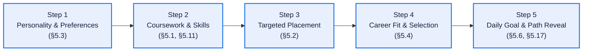
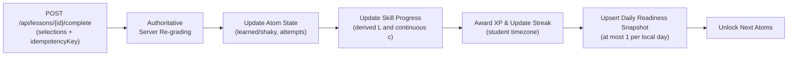

# 05 — MVP Features

**Document owners:** Backend + Frontend · **Status:** Revised <2026-11-15> (atomic roadmap + defect fixes)

Every feature below states its purpose, inputs, algorithm, a worked example, its acceptance
criteria, and what happens when a dependency fails. A feature without a stated algorithm is a
feature nobody can implement twice the same way.

---

## Feature index

| § | Feature | Tier | Owner |
|---|---|---|---|
| 5.0 | [Onboarding & Plan Creation Wizard](#50-onboarding--plan-creation-wizard) | MVP | Mazen · Mohamed Y. · Ziad |
| 5.1 | [Student Profile](#51-student-profile) | MVP | Mohamed Y. · Mazen |
| 5.2 | [Placement and Checkpoints](#52-placement-and-checkpoints) | Should | Mohamed Y. · Mazen |
| 5.3 | [Career Assessment](#53-career-assessment) | MVP | Mohamed Y. · Mazen |
| 5.4 | [Career Recommendation](#54-career-recommendation) | MVP | **Ahmed Y. (AI)** · Ziad (integration) |
| 5.5 | [**Skill-Gap Analysis**](#55-skill-gap-analysis--core) | **MVP — Core** | Osama · Ziad |
| 5.6 | [**Atomic Roadmap**](#56-atomic-roadmap--core) | **MVP — Core** | Osama · Ziad |
| 5.7 | [Career Readiness Score](#57-career-readiness-score) | MVP | Osama · Mazen |
| 5.8 | [Project Recommendations](#58-project-recommendations) | MVP | Mohamed Y. · Mazen |
| 5.9 | [Lessons, Mastery and Progress](#59-lessons-mastery-and-progress) | MVP | Osama · Mazen |
| 5.10 | [Learning Resources](#510-learning-resources) | Should | Mohamed Y. · Mazen |
| 5.11 | [University Curriculum Mapping](#511-university-curriculum-mapping) | Should | Mohamed Y. · Mazen |
| 5.12 | [Internship Readiness Checklist](#512-internship-readiness-checklist) | Should | Mohamed Y. · Mazen |
| 5.13 | [Advisor Dashboard](#513-advisor-dashboard) | Should | Osama · Mazen |
| 5.14 | [What-If Target Comparison](#514-what-if-target-comparison) | Should | Osama · Ziad |
| 5.15 | [Explainability Panel](#515-explainability-panel) | Should | Ziad |
| 5.16 | [Admin Content Panel](#516-admin-content-panel) | MVP | Mohamed Y. · Mohamed Salah |
| 5.17 | [Lesson Player](#517-lesson-player) | MVP | Ziad · Mazen · Yousef K. |
| 5.18 | [Gamification (XP, Streak, Daily Goal)](#518-gamification) | MVP | Osama · Mazen · Yousef K. |
| 5.19 | [Review and Retention (Spaced Practice)](#519-review-and-retention) | Should | Osama · Ziad |
| 5.20 | [Content Operations & Quality Queue](#520-content-operations) | MVP | Mohamed Salah · Mohamed Y. |

The AI Mentor is specified in [§06](06-ai-engines.md#4-engine-c--context-aware-ai-mentor-rag).

---

## 5.0 Onboarding & Plan Creation Wizard

**Purpose:** guide first-time students through a cohesive, friction-free journey from initial curiosity to an active atomic roadmap and their first completed micro-lesson.
**Requirements:** FR-00 · **Story:** US-00 · **Owners:** Mazen · Mohamed Y. · Ziad

### The 5-step sequence



| Step | User Action | System Output | Duration |
|:-:|---|---|:-:|
| **1** | Answers 20 Likert items on interests, problem types, and work preferences | Produces normalized `interest_vector` | $\le 4$ min |
| **2** | Selects academic year and completed Suez Canal courses; adds claimed technical skills (0–5 scale) | Pre-fills unverified skills via curriculum mapping (manual entry is baseline if mapping unavailable); initializes `student_skill` | $\le 3$ min |
| **3** | Optional diagnostic placement probe for top 2–3 claimed core skills (adaptive probe; can be skipped) | Marks in-scope atoms up to tested band as `assumed` (`verified=true`, capped at level 4); unverified claims remain `verified=false` | $\le 5$ min |
| **4** | Reviews ranked careers with match scores and fit breakdowns; commits to target career and track | Persists `target_career_id` and `target_track_id`; initializes `student_path_prefs` | $\le 2$ min |
| **5** | Selects daily study goal (10, 20, 30, 45, or 60 min, defaulted from weekly hours) | Reveals personal atomic path (units, atoms, projected finish) and immediately opens the first micro-lesson | Instant |

### Usability target (NFR-04)

- A new student starts their first micro-lesson in **$\le 10$ minutes** unaided with placement probe skipped; **$\le 15$ minutes** with placement.
- Gap analysis and career ranking are available immediately upon career selection ($\approx 9$ minutes without placement).

### Resume, state recovery, and precondition validation (F-30)

- The student's progress is saved on every answer submission (`onboarding_step` in `STUDENT_PROFILE`).
- If a student closes the browser at Step 3, logging back in automatically resumes at Step 3 with prior answers intact.
- Calling `PUT /api/profile/onboarding/step` is step-gated: the server validates that prerequisites of the requested step exist. If prerequisites are missing, the endpoint returns `422 PRECONDITION_UNMET`. Steps advance only by completing real actions.
- Completing Step 5 sets `onboarding_completed_at` and unlocks the primary dashboard.

---

## 5.1 Student Profile

**Purpose:** establish the baseline data that every other feature consumes.
**Requirements:** FR-01…FR-07 · **Story:** US-01

### Inputs

| Field | Type | Required |
|---|---|---|
| Academic year | 1–5 | Yes |
| Interests | multi-select from a fixed list | Yes, $\ge 3$ |
| Skills | skill + level 0–5 | Yes, $\ge 5$ |
| Completed courses | multi-select from department catalogue | No |
| Hours available per week | 1–60 | Yes |
| Daily goal | 10, 20, 30, 45, 60 minutes | Yes (default derived from hours/week) |
| Timezone | IANA timezone string | Yes (default `Africa/Cairo`) |
| Career goal | free text, $\le 500$ characters | No |
| Evidence URL per skill | URL | No |

### Profile completeness

Shown as a percentage so the student sees what is missing:

```text
completeness = 0.20 · min(skills_rated / 15, 1)
             + 0.15 · min(interests / 5, 1)
             + 0.15 · (academic_year set)
             + 0.15 · (hours_per_week set)
             + 0.20 · min(courses / 8, 1)
             + 0.15 · min(verified_skills / 5, 1)
```

Below 60 %, gap analysis still runs but the UI carries an informational warning that results will be coarse. A partial answer with an honest caveat beats a blocking form.

### Acceptance criteria

US-01 AC1–AC6. Additionally: free text is length-limited and escaped on render ([NFR-10](02-requirements.md#nfr-10--input-handling-and-injection-resistance)), and skill search matches aliases so typing "Postgres" finds "PostgreSQL".

---

## 5.2 Placement and Checkpoints

**Purpose:** objective verification of claimed knowledge and unit mastery, preventing self-assessment bias without blocking onboarding.
**Requirements:** FR-09, FR-43, FR-44 · **Story:** US-02, US-15 · **Status:** Supersedes legacy calibration quizzes

> **Supercession Note:** The previous monolithic calibration quiz (`QUIZ_ITEM`) is replaced by **adaptive placement probes** during onboarding and **end-of-unit checkpoints** in the atomic roadmap. Both draw from the unified `EXERCISE` table.

### Adaptive placement probe (Wizard Step 3 & On-demand)

1. When a student claims core technical skills (e.g. SQL, Git, OOP), they are offered a focused diagnostic probe of up to 8 exercises flagged `is_placement_probe = true` (pool $\ge 20$ items per skill, $\ge 3$ per band 1–4).
2. The probe uses an adaptive up/down procedure:
   - Start at claimed band $k$.
   - 2/2 correct $\implies$ move up one band.
   - 0/2 correct $\implies$ move down one band.
   - 1/2 correct $\implies$ present 1 tie-breaker probe.
   - Stop after 8 probes or when the boundary is established.
3. A band is passed if the student scores $\ge 2$ correct at that band.
4. **Verified level is capped at level 4** (level 5 is self-reported mastery, never verified via MCQ). The verified level never exceeds `claim + 1`.
5. Atoms in bands $\le \text{verified level}$ are marked `assumed`, `verified = true`, `assumed_source = 'placement'`.
6. If the verified level is 2 or more levels below the claim, the UI displays a constructive notice: *"Your placement suggests level 2 rather than 4. We've placed foundational units on your path so you have a solid footing."*
7. Retakes are permitted after 7 days; exercises are sampled without replacement across retakes.

### Checkpoints and unit test-outs

- Every unit ends with an **8-exercise Checkpoint** sampled from its atoms (prioritizing unverified assumed atoms, then standard atoms).
- Passing threshold is **$\ge 75\%$**.
- **Reopen rule:** If a unit contains unverified assumed atoms (e.g. from course mapping or self-claims) and checkpoint accuracy is $< 60\%$, those unverified atoms are reopened (their assumed status is cleared, unlocking them for active study).
- **Test-out:** A student can attempt a unit Checkpoint early directly from the unit header. Scoring **$\ge 85\%$** marks all in-scope atoms of that unit as `assumed` (`source = 'test_out'`, `verified = true`).

---

## 5.3 Career Assessment

**Purpose:** capture interests and work preferences, which skills alone do not reveal.
**Requirements:** FR-08 · **Story:** US-03

Structure — canonical **20 Likert items, completed in $\le 4$ minutes**:

| Section | Items | Description |
|---|:---:|---|
| Interest areas | 7 | Weighted interest vector across CS domains |
| Work-style preferences | 4 | Team vs solo, breadth vs depth, product vs research |
| Problem-type preferences | 6 | Systems, data, visual, security, infrastructure, algorithms |
| Career intent | 3 | Employment vs graduate study, regional market, timeline |

Answers are Likert (1–5). The resulting normalized `interest_vector` feeds the recommendation service's interest term ([§5.4](#54-career-recommendation)).

---

## 5.4 Career Recommendation

**Purpose:** rank the 6 careers for this specific student with inspectable reason badges.
**Requirements:** FR-10, FR-11 · **Story:** US-03 · **Flow:** [§03 7.1](03-architecture.md#71-career-recommendation--model-first-with-a-fastapi-fallback)

### Model-first design

Career recommendation is a model-first pipeline executed inside the internal FastAPI service:

| Stage | Method | Responsibility | Failure handling |
|---|---|---|---|
| 1 | Embedding | MiniLM-L6-v2 profile embedding | FastAPI handles inference failure |
| 2 | Semantic scoring | Score profile embedding against candidate career vectors supplied by .NET | Replaces retrieval over 6 careers (F-23) |
| 3 | Reranker | Produce primary career relevance/ranking signal | Open Decision OD-1 (learned ranker vs cross-encoder) |
| 4 | Mandatory constraints | Enforce deterministic business rules | Evaluated in FastAPI |
| 5 | Final recommendation | Return ranked careers, inspectable baseline breakdown, and metadata | Returned to .NET |

### Mandatory recommendation constraints (F-23)

1. **Active status:** Inactive careers and tracks are never returned.
2. **Content availability threshold:** A career is recommendable only if its atomic path has $\ge 60\%$ of in-scope atoms in `published` status. Otherwise, it is returned with `contentLimited: true` and cannot be ranked above a fully available career whose score is within 5 points.
3. **Deterministic ordering:** Every career receives a unique rank and score in 0–100; ties break by score DESC, then `careerId` ASC.
4. **Zero-skills handling:** A profile with zero rated skills runs in interest-only mode with `lowConfidence: true`.
5. **Completeness:** The response always returns all 6 careers.

### Deterministic baseline and explainability

The deterministic baseline is computed inside FastAPI and returned in the public `breakdown` object (`{ constraintStatus, modelScore, baselineScore, skillFit, interestFit, coverage }`):

```text
skill_fit(u,c) = Σ_{s ∈ req(c)}  importance(s,c) · min(level(u,s), required(s,c)) / required(s,c)
                 ─────────────────────────────────────────────────────────────────────────────
                                    Σ_{s ∈ req(c)}  importance(s,c)

interest_fit(u,c) = cosine( interest_vector(u), interest_profile(c) )

coverage(u,c)   = |{ s ∈ req(c) : level(u,s) ≥ 1 }| / |req(c)|

baseline(u,c)   = 100 · ( 0.55 · skill_fit + 0.30 · interest_fit + 0.15 · coverage )
```

Reason badges in the UI render the baseline terms (`skill_fit`, `interest_fit`, `coverage`). The documentation plainly notes that badges explain *the baseline view* of the match, not the model's internal latent weights.

### Worked reference example (F-05 verified)

Mariam: Python 3, Java 2, SQL 2, HTML/CSS 3, JavaScript 2, Git 3, Linux 1; interests analytical + visual. Round half up.

| Career | skill\_fit | interest\_fit | coverage | baseline | baseline rank | model | final (model-first) | final rank |
|---|---:|---:|---:|---:|---:|---:|---:|---:|
| **Frontend / Full-Stack** | 0.58 | 0.81 | 0.72 | 67 | 1 | 0.74 | **74** | 1 |
| **AI / Machine Learning** | 0.38 | 0.80 | 0.48 | 52 | 4 | 0.72 | **72** | 2 |
| **Backend Development** | 0.54 | 0.62 | 0.68 | 59 | 2 | 0.71 | **71** | 3 |
| **Data Engineering / DS** | 0.46 | 0.78 | 0.55 | 57 | 3 | 0.69 | **69** | 4 |
| **DevOps / Cloud** | 0.29 | 0.41 | 0.40 | 34 | 5 | 0.52 | **52** | 5 |
| **Cybersecurity** | 0.24 | 0.38 | 0.35 | 30 | 6 | 0.44 | **44** | 6 |

*Key observation:* The model reorders AI / Machine Learning above Backend Development; this is exactly the kind of disagreement that research question RQ1 measures.

### Graceful degradation (F-24)

If FastAPI is unreachable, times out (> 8 s), or fails during cold start, .NET returns HTTP 200 with `mode: "unavailable"`, listing all 6 careers unranked with static descriptions and a retry button. If a recommendation was previously computed for the profile, it is served from cache with a "computed earlier" badge. The student may select a target career regardless of AI service state.

---

## 5.5 Skill-Gap Analysis — CORE

**Purpose:** quantify precisely what the student is missing against their committed career and track.
**Requirements:** FR-12…FR-15 · **Story:** US-04 · **Owner:** Osama

### Algorithm

For each required skill $s$ of target career $c$ and track $t$:

```text
current   = effective_level(u, s)          -- derived integer mastery L(s) from v_effective_level
required  = required_level(s, c, t)
gap       = max(0, required − current)
priority  = gap × importance(s, c)         -- computed in decimal numeric(3,2)
satisfaction = min(current, required) / required
```

### Monotone severity boundaries (F-16)

Stored `importance` is `numeric(3,2)`. `priority` is calculated in exact decimal hundredths:

| Evaluation Order | Severity | Condition | Meaning |
|:---:|---|---|---|
| 1 | **Strength** | `current > required` | Exceeds career standard |
| 2 | **Met** | `gap == 0` | Exactly satisfies requirement |
| 3 | **Critical** | `priority >= 1.50` | Blocking prerequisite for the career |
| 4 | **Moderate** | `0.75 <= priority < 1.50` | Important gap to address |
| 5 | **Minor** | `0.00 < priority < 0.75` | Desirable improvement |

### Worked example — Omar targeting Backend Development (.NET track)

All 11 skills reproduced with verified decimal boundaries:

| Skill | Imp. | Required | Current | Gap | Priority | Severity | Next Level Progress |
|---|---:|:-:|:-:|:-:|---:|---|:---:|
| **Docker** | 0.65 | 3 | 0 | 3 | **1.95** | ✖ Critical | 0 % |
| **Testing** | 0.75 | 3 | 1 | 2 | **1.50** | ✖ Critical | 25 % |
| **Auth & Security** | 0.60 | 3 | 1 | 2 | 1.20 | ▲ Moderate | 40 % |
| **CI/CD** | 0.50 | 2 | 0 | 2 | 1.00 | ▲ Moderate | 0 % |
| **REST API Design** | 0.90 | 4 | 3 | 1 | 0.90 | ▲ Moderate | 50 % |
| **SQL** | 0.85 | 4 | 3 | 1 | 0.85 | ▲ Moderate | 50 % |
| **Relational DB Design**| 0.75 | 3 | 2 | 1 | 0.75 | ▲ Moderate | 60 % |
| **Cloud Basics** | 0.40 | 2 | 1 | 1 | 0.40 | ● Minor | 0 % |
| **C# / .NET** | 0.95 | 4 | 4 | 0 | 0.00 | ✔ Met | 100 % |
| **Linux Basics** | 0.45 | 2 | 2 | 0 | 0.00 | ✔ Met | 100 % |
| **Git** | 0.80 | 3 | 4 | 0 | 0.00 | ★ Strength | 100 % |

*Notes:*

- **Boundary check:** Testing at priority exactly 1.50 evaluates to **Critical** (inclusive lower bound). Relational DB Design at 0.75 evaluates to **Moderate**.
- **Actionable link:** Tapping "Close this gap" on any row directly navigates to and highlights the next uncompleted atom for that skill in the student's atomic roadmap.

---

## 5.6 Atomic Roadmap — CORE

**Purpose:** convert skill gaps into a structured personal path of bite-sized units and atoms.
**Requirements:** FR-37…FR-39 · **Story:** US-05, US-16 · **Status:** Supersedes phase-based roadmaps

### Principles: determinism, stability, and pedagogy

1. **Authored canonical order:** Each `PATH` contains an ordered list of curated units (`PATH_UNIT.sequence`, grouped across 4 stages: Foundations, Core, Advanced, Job-ready). CI graph validators enforce that unit sequence never violates hard skill or atom prerequisites.
2. **Path scoping:** An atom is in-scope for a student iff its skill belongs to the requirement set of the committed (career, track) with $\text{band} \le \text{required\_level}$, or belongs to a foundational unit.
3. **OR-group stability:** OR-group representatives are chosen once at path creation time (`STUDENT_PATH_PREFS.or_group_choices_json`) and stay fixed during learning.
4. **Filtering:** Atoms in `learned` or `assumed` state are marked completed; units whose in-scope atoms are completed show as passed.
5. **Modes:**
   - `canonical` (default): Follows the authored pedagogical sequence.
   - `prioritized`: Re-sorts units **within each stage** by `(max_unit_gap_priority DESC, remaining_minutes ASC, unit_slug ASC)` subject to hard prerequisites.
6. **Projected finish dates:**
   $$\text{Projected Weeks} = \frac{\sum_{a \in \text{remaining in-scope atoms}} a.\text{estimated\_minutes}}{\text{hours\_per\_week} \times 60}$$
   Displayed as a realistic projection per unit and stage, never an absolute promise.

### Illustrative student path segment — Omar (.NET track)

| Stage | Unit | Theme | Atoms | Minutes | Checkpoint |
|---|---|---|:---:|:---:|:---:|
| **Foundations** | `sql-fundamentals` | Relational Modeling & Queries | 16 | 80 min | Available |
| **Core** | `dotnet-api-core` | ASP.NET Core & REST Controllers | 22 | 110 min | Locked |
| **Core** | `docker-essentials` | Containerizing Web Services | 18 | 90 min | Locked |

---

## 5.7 Career Readiness Score

**Purpose:** one headline number the student can watch move smoothly with every completed micro-lesson.
**Requirements:** FR-13, FR-42 · **Story:** US-04, US-06

### Formula using continuous mastery

```text
readiness = 100 · Σ_{s ∈ req(c)} importance(s) · min(c(s), required(s))
                  ─────────────────────────────────────────────────────
                         Σ_{s ∈ req(c)} importance(s) · required(s)
```

Where continuous level $c(s)$ is:
$$c(s) = L(s) + \min\left(1, \frac{m_{L+1}}{\tau}\right) \quad (\text{with } \tau = 0.80)$$

Properties:

- **Smooth feedback:** Every completed atom increases $m_{L+1}$, raising $c(s)$ and immediately lifting the headline readiness score.
- **Monotone with progress:** Learning progress can only increase readiness. Recalibration via placement can lower it (the UI states this plainly). Spaced repetition decay **never** reduces readiness or $L(s)$ (F-19).
- **Importance-weighted and bounded in $[0, 100]$.**

### Worked example — Omar

Baseline readiness:
$$\text{Numerator} = 15.60, \quad \text{Denominator} = 24.15, \quad \text{Readiness} = \frac{15.60}{24.15} \times 100 = 64.60\% \implies \mathbf{65\%}$$

Omar completes 4 atoms out of 10 in SQL Band 4:
$$m_4 = \frac{4}{10} = 0.40, \quad c(\text{SQL}) = 3 + \frac{0.40}{0.80} = 3.50$$
The numerator increases by $0.85 \times 0.50 = 0.425 \implies 16.025$.
New readiness:
$$\text{Readiness} = \frac{16.025}{24.15} \times 100 = \mathbf{66.36\%} \quad (+1.76\% \text{ gain})$$
The integer gap table continues to display "SQL $3 \to 4$" until band 4 reaches $\ge 80\%$, but the student sees immediate continuous reward.

---

## 5.8 Project Recommendations

**Purpose:** practical portfolio milestones ending each stage.
**Requirements:** FR-21, FR-22, FR-53 · **Story:** US-05, US-09

- Each Stage ends with a **project node**.
- Projects provide 3–6 self-attested milestone criteria with optional repository links.
- Completing a project records a `STUDENT_PORTFOLIO_ITEM`, awards 50 XP, and marks criteria in the Internship Checklist.
- **Capstone Project:** Evaluated against *projected* skill levels at the end of the Job-ready stage; requires covering $\ge 3$ target gap skills.

---

## 5.9 Lessons, Mastery and Progress

**Purpose:** authoritative lesson evaluation, mastery derivation, and idempotent state synchronization.
**Requirements:** FR-40…FR-42 · **Story:** US-06, US-12 · **Status:** Supersedes manual progress increments

### Mastery derivation rules

1. For each band $b \in \{1..5\}$ of skill $s$:
   $$m_b = \frac{|\{a \in \text{atoms}(s, b) : a.\text{status} \in \{\text{'learned'}, \text{'assumed'}\}\}|}{|\{a \in \text{atoms}(s, b) : a.\text{status} = \text{'published'}\}|}$$
2. Derived integer level $L(s)$ is the largest integer such that for all $b \le L(s)$, $m_b \ge \tau$ ($\tau = 0.80$).
3. Continuous level: $c(s) = L(s) + \min(1, m_{L+1} / \tau)$.
4. If a lesson is completed with first-try accuracy $\ge 60\%$, the atom becomes `learned` (placed in Leitner Box 1); otherwise `shaky`.

### Transactional completion cascade



All steps run in a single database transaction ($\le 8$ queries). Idempotency ensures duplicate network requests replay the exact same response without double-awarding XP or streak days.

---

## 5.10 Learning Resources

**Purpose:** optional deep-dive reading for students desiring comprehensive theory beyond micro-lessons.
**Requirements:** FR-20 · **Story:** US-05

- Attached directly to atoms via `ATOM_RESOURCE`.
- Strictly curated external links (target $\approx 250$ across the catalogue, all free). Never LLM-generated.
- Monthly link checker flags broken links in the admin queue.

---

## 5.11 University Curriculum Mapping

**Purpose:** bridge university transcripts to starting atomic paths.
**Requirements:** FR-05 · **Story:** US-11

- Maps courses to skills (`COURSE_SKILL`) and specific atoms (`COURSE_ATOM`).
- When a student confirms completed courses, mapped atoms become `assumed` (`source = 'course'`, `verified = false`).
- Generates an institutional gap report for Dr. Hend: *Market-demanded atoms not covered by any Suez Canal CS course*.

---

## 5.12 Internship Readiness Checklist

**Purpose:** provide an actionable, objective checklist for job readiness.
**Requirements:** FR-30, FR-53 · **Story:** US-09

- Evaluates minimum skill thresholds from derived mastery $L(s)$.
- Portfolio requirements derive from completed stage project nodes (`STUDENT_PORTFOLIO_ITEM`).
- CV review and algorithm practice criteria are self-declared checkboxes (F-20).

---

## 5.13 Advisor Dashboard

**Purpose:** institutional visibility into student cohort gaps.
**Requirements:** FR-31…FR-33, FR-54 · **Story:** US-10, US-18

### Privacy and aggregation (F-31)

- Reads only profiles with `consent_advisor_visibility = true`.
- Cell suppression strictly enforces: any cell with fewer than $k = 5$ students displays `—` (with complementary row/column suppression to prevent differencing attacks).
- Seeded synthetic cohort available for live demo.

### Atom-level cohort analytics

Ranks the most-failed atoms and units across the student cohort, showing faculty precisely where lecture interventions are needed.

---

## 5.14 What-If Target Comparison

**Purpose:** compare readiness and time investment across targets before committing.
**Requirements:** FR-15 · **Story:** US-08

Compares the current profile against an alternative career without mutating saved preferences, reporting readiness percentage, critical gaps, and projected weeks to complete.

---

## 5.15 Explainability Panel

**Purpose:** ensure every recommendation is transparent and defensible.
**Requirements:** supports US-03 AC2 and US-04 AC3

Exposes:

- **Why this career ranked here:** baseline terms (`skill_fit`, `interest_fit`, `coverage`).
- **Why this atom is here:** prerequisite lineage, importance weight source, and skill gap priority.
- **Why this unit is next:** stage sequence and gap priority rank.

---

## 5.16 Admin Content Panel

**Purpose:** content management and curriculum validation without writing SQL.
**Requirements:** FR-34…FR-36, FR-50, FR-51

- Automated graph validator: verifies acyclicity, orphan atoms, and minimum atoms per band ($\ge 3$).
- Content status queue: `draft` $\to$ `reviewed` $\to$ `published`.
- Issue reports triage queue for student-reported content problems.
- One-click static bundle publishing (`publish-content`).

---

## 5.17 Lesson Player

**Purpose:** interactive micro-lesson delivery with instant feedback.
**Requirements:** FR-40 · **Story:** US-12 · **Status:** New feature

- Full-screen distraction-free player with segmented progress bar.
- Supported exercise types: `concept_card`, `multiple_choice`, `multi_select`, `true_false_code` (spot the bug), `fill_blank_tokens`, `reorder_tokens`, `match_pairs`, `predict_output`.
- Instant local evaluation via static unit bundle; wrong answers re-queued at the end of the session.
- Sticky action sheet with explanation snippet, keyboard shortcuts (Enter / 1–4 keys), and screen-reader announcements.

---

## 5.18 Gamification

**Purpose:** sustain consistent daily study habits through ethical motivation mechanics.
**Requirements:** FR-45, FR-47, FR-48, FR-49 · **Story:** US-13 · **Status:** New feature

- **XP values:** Lesson base 10 XP; +5 bonus for 100% accuracy; +2 bonus for $\ge 80\%$; Review 8 XP; Checkpoint 25 XP; Project milestone 50 XP; Replays 2 XP (max 20 XP/day).
- **Streak calculation:** Evaluated against student's IANA timezone (`Africa/Cairo`) using an injected clock. Streak freezes (max 2) consumed automatically for missed days.
- **Exam-Week Pause:** Students can pause streaks for up to 14 days during university exam periods (max twice per academic term).
- **Ethics (NFR-18):** No blocking hearts or lives; mistakes cost only an in-session re-queue. No guilt-tripping notifications.

---

## 5.19 Review and Retention

**Purpose:** long-term retention of learned concepts via spaced repetition.
**Requirements:** FR-46 · **Story:** US-14 · **Status:** New feature

- Leitner 5-box system with intervals of 1, 3, 7, 14, and 30 days.
- Dedicated "Practice" tab displaying due atom counts; review sessions present up to 8 mixed items.
- Decayed review strength never reduces derived mastery $L(s)$ or career readiness.

---

## 5.20 Content Operations

**Purpose:** maintainable, high-volume authoring of the $\approx 4,050$ atom corpus.
**Requirements:** FR-50, FR-51 · **Status:** New feature

- Offline LLM-assisted drafting with strict schema checks and automated blind-solve verification.
- Human review budget ($\approx 4$ min/atom) with double-review on level 4–5 atoms.
- Release tiers: Tier 1 (1,000 atoms, W17), Tier 2 (2,200 atoms, W23), Tier 3 (4,050 atoms, W28). Detailed in [14 — Content Pipeline](14-content-pipeline.md).

---

**Next:** [06 — AI Engines](06-ai-engines.md)
