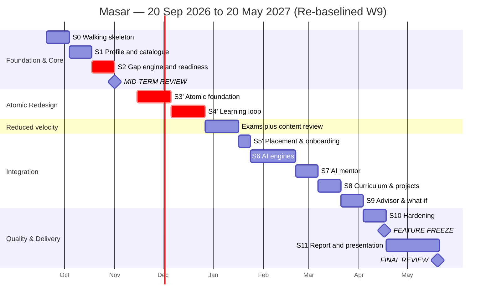

# 08 — Plan & Timeline

**Document owner:** Abdelrahman Megahed · **Status:** Revised <2026-11-15> (atomic roadmap + defect fixes)

**Start:** Sun 20 Sep 2026 · **Mid-term review:** Sun 1 Nov 2026 (Week 7) ·
**Final review:** Thu 20 May 2027 (Week 35) · **35 weeks total**

---

## 0. Re-baseline (2026-11-15, Week 9)

Today is **Sun 15 Nov 2026 = Week 9** of the 35-week graduation project plan. The mid-term review date (Sun 1 Nov 2026) has passed.

At Week 9, the team executed an architectural re-baseline ([ADR-0007](adr/0007-atomic-roadmap.md), [ADR-0010](adr/0010-lesson-grading-authority-and-content-delivery.md)) to transition from 40-hour phase scheduling to the **Atomic Roadmap and micro-lesson learning loop** (~4,050 atoms). Slices S3–S5 are restructured as S3′, S4′, and S5′, AI workstreams shift by one week, and content authoring is established as a parallel offline pipeline (Tier 1 by W17, Tier 2 by W23, Tier 3 by W28).

---

## 1. Two changes from the original plan

**Vertical slices, not horizontal layers.** Every slice below is **independently demonstrable end-to-end**, ensuring integration risk is paid down continuously rather than in April.

**Real dates.** Fixed defence dates work backwards from the deadline with a strict feature freeze on Fri 17 Apr 2027.

---

## 2. Priority matrix — single source of truth

| Feature | Tier | Owner | Depends on | Demo-critical | Fallback if it fails |
|---|---|---|---|:-:|---|
| **Skill-Gap Analysis** | 🔴 Core | Osama | Profile, Career DB | **Yes** | None — pure computation |
| **Atomic Roadmap & Lesson Loop** | 🔴 Core | Osama · Ziad | Atom graph, prereqs | **Yes** | None — pure computation |
| Lesson Player | 🔴 Core | Ziad · Mazen | Static bundles | **Yes** | Simplified question runner |
| Student Profile | 🟡 MVP | Mohamed Y. | Skill catalogue | Yes | — |
| Onboarding Wizard | 🟡 MVP | Mazen | Assessment, Profile | Yes | Direct profile entry (F-06) |
| Career & Skill Database | 🟡 MVP | Mohamed Y. | Seed data | Yes | Hand-curated O\*NET/ESCO |
| Career Recommendation (AI model) | 🟡 MVP | Ahmed Y. | Profile, FastAPI Svc | Yes | FastAPI deterministic fallback |
| Deterministic Recommendation Baseline | 🟡 MVP *(eval/fallback)* | Ahmed Y. | RQ1 comparison | No | FastAPI deterministic fallback |
| Career Assessment (20 items) | 🟡 MVP | Mohamed Y. | — | Yes | — |
| Mastery Derivation & Readiness | 🟡 MVP | Osama | Atom states | **Yes** | None — deterministic view |
| XP, Streak & Daily Goal | 🟡 MVP | Osama · Mazen | Lessons, Timezone | **Yes** | Local daily counters |
| Content Factory Pipeline | 🟡 MVP *(offline)* | Mohamed Salah · Ahmed Y. | Dev LLM quota | No | Human outlines & reduced careers |
| Job-Skill Extraction | 🟡 MVP *(offline)* | Ahmed Y. | Job corpus | No | Alias dictionary + taxonomy |
| Learning Resources (Deep dives) | 🟡 MVP | Mohamed Y. | Curated seed | Yes | — |
| Project Stage Nodes | 🟡 MVP | Mohamed Y. | Gaps, projects | Yes | — |
| Admin Content Panel | 🟡 MVP | Mohamed Y. · Mohamed Salah | Admin role | No | Direct SQL |
| Demo Mode | 🟡 MVP | Mohamed Salah | Fixtures | **Yes** | — |
| Adaptive Placement & Checkpoints | 🔵 Should | Mohamed Y. · Mazen | Exercises | No | Self-report only, unverified |
| Spaced Review Queue (Leitner) | 🔵 Should | Osama · Ziad | Learned atoms | No | Chronological practice |
| Exam-Week Streak Pause | 🔵 Should | Osama | Student game state | No | Manual streak freezes |
| AI Mentor (Atom retrieval) | 🔵 Should | Ahmed Y. · Ziad | Atom vectors, LLM | No | Stored exercise explanations |
| Curriculum-to-Atom Mapping | 🔵 Should | Mohamed Y. | Course catalogue | No | Reduced course subset |
| Internship Readiness Checklist | 🔵 Should | Mohamed Y. | Project nodes | No | — |
| Advisor Atom Analytics | 🔵 Should | Osama | Student atom states | No | — |
| What-If Target Comparison | 🔵 Should | Osama | Gap engine | No | — |
| Explainability Panel | 🔵 Should | Ziad | Domain calculators | No | — |
| Achievements & Quests | ⚪ Later/Could | Mazen · Yousef K. | Game state | No | Cut first |
| Weekly Leagues (Opt-in) | ⚪ Later/Could | Mazen | XP totals | No | Cut first |
| Evidence on skill claims | ⚪ Later | — | Portfolio items | No | — |
| Mobile App (Native) | ⚪ Later | — | API | No | Responsive PWA |

### Tier definitions

- 🔴 **Core:** The project has no demonstrable value proposition without this. Two features qualify: **Skill-Gap Analysis** and the **Atomic Roadmap with Lesson Loop**.
- 🟡 **MVP:** Required for a complete product experience.
- 🔵 **Should:** Materially better product, built after the MVP is stable.
- ⚪ **Later/Could:** Scope buffers cut first under pressure.

---

## 3. Slice plan

*Note on status:* As of Week 9 re-baseline (Sun 15 Nov 2026), mid-term review is in the past. Slice completion states are subject to formal confirmation by project lead Abdelrahman Megahed.

| Slice | Weeks | Dates | Content | Status |
|---|---|---|---|---|
| **S0 Walking skeleton** | W1–W2 | 20 Sep – 3 Oct | Repositories, Docker compose, CI/CD, .NET/React/FastAPI scaffolds, auth, initial API contract frozen | to be confirmed by Abdelrahman |
| **S1 Profile & catalogue** | W3–W4 | 4–17 Oct | 60 skills seeded, aliases, profile CRUD, completeness, consent, prerequisite DAG v1 | to be confirmed by Abdelrahman |
| **S2 Gap engine & readiness** | W5–W6 | 18–31 Oct | 6 careers seeded, `GapCalculator`, `ReadinessCalculator`, gap UI with severity, demo mode | to be confirmed by Abdelrahman |
| 🎯 **Milestone: Mid-Term Review** | W7 | **Sun 1 Nov 2026** | Demonstrated core gap analysis and readiness score to supervisor | Completed (past) |
| **S3′ Atomic foundation** | W9–W11 | 15 Nov – 5 Dec | Atom/Unit/Path schema & migrations; CI validator; `PathBuilder`, `MasteryCalculator` with tests; **API v2 contract frozen at end of W10**; lesson player prototype with 3 exercise types on pilot unit (`sql-fundamentals`, ≈ 150 atoms); design tokens v1; content factory v1 | In progress |
| **S4′ Learning loop** | W12–W14 | 6–26 Dec | Lesson API with authoritative re-grading and idempotency; XP, streak, daily goal; incremental readiness; path UI with virtualisation; static bundle publishing; Tier-1 content running at ≈ 170 atoms/week; 20-item assessment, baseline recommendation, wizard shell | Scheduled |
| ⏸ **Exam block** | W15–W17 | 27 Dec – 16 Jan | Human review of drafts; **Tier 1 (≈ 1,000 atoms) completed**; usability round 1 (lesson player focus); job corpus collection & labelling | Scheduled |
| **S5′ Placement & onboarding** | W18 start | 17–23 Jan | Wizard completed with adaptive placement and daily goal; checkpoints & unit test-outs; spaced review queue (Should) | Scheduled |
| **S6 AI engines** | W19–W22 | 24 Jan – 20 Feb | Job extraction layers 1–4 ([RQ2](09-evaluation.md#rq2)); corpus importance weights; sentence embeddings; model-first career recommendation + [RQ1](09-evaluation.md#rq1) measurement | Scheduled |
| **S7 AI mentor** | W23–W24 | 21 Feb – 6 Mar | Sanitised Context DTO, RAG with atom retrieval, prompt injection hardening, stored explanations fallback, mentor grounding audit ([RQ4](09-evaluation.md#rq4)) | Scheduled |
| **S8 Curriculum & projects** | W25–W26 | 7–20 Mar | Suez Canal curriculum mapping to atoms; stage project nodes; capstone selection; Faculty curriculum coverage report | Scheduled |
| **S9 Advisor & what-if** | W27–W28 | 21 Mar – 3 Apr | Advisor atom analytics ($k \ge 5$ suppression); internship checklist; what-if comparison; **Tier 3 content completes W28** | Scheduled |
| **S10 Hardening** | W29–W30 | 4–17 Apr | **Content freeze W29**; E2E tests per user story; accessibility audit; load test (50 concurrent); security review; usability round 2; **Feature freeze Fri 17 Apr 2027** | Scheduled |
| **S11 Report & defence** | W31–W35 | 18 Apr – 20 May | Full report draft, evaluation analysis scripts ([RQ1](09-evaluation.md#rq1)–[RQ8](09-evaluation.md#rq8)), slide deck, full dress rehearsal, defence on **Thu 20 May 2027** | Scheduled |

### Honest scheduling note

Compressing S6–S10 to absorb the W9 redesign is challenging. If development velocity falls behind, contingency cuts will execute immediately in the agreed order below. At no point will feature freeze (Fri 17 Apr 2027) be compromised.

---

## 4. Timeline overview

---

## 5. Milestones

| Milestone | Date | Week | Definition of done |
|---|---|:-:|---|
| Walking skeleton | 3 Oct 2026 | 2 | Staging deploy, 3 services communicating, baseline API contract |
| Core value loop | 31 Oct 2026 | 6 | Gap analysis and baseline readiness score working live |
| Mid-term review | **1 Nov 2026** | **7** | Demonstrated to supervisor (past) |
| **API v2 contract freeze** | **5 Dec 2026** | **11** | v2.0.0 OpenAPI spec frozen for atomic roadmap and lesson player |
| Full learning loop | 26 Dec 2026 | 14 | Lesson player, re-grading, XP, streak, daily goal, static bundles |
| **Tier 1 Content (1,000 atoms)** | **16 Jan 2027** | **17** | Shared foundations + Backend (.NET) atoms reviewed & published |
| Intelligence integrated | 6 Mar 2027 | 24 | Extraction, embeddings, model-first recommendation, mentor with retrieval |
| **Tier 3 Content (4,050 atoms)**| **3 Apr 2027** | **28** | Full curriculum atoms across all 6 careers completed |
| **Content freeze** | **10 Apr 2027** | **29** | Content authoring locked; QA and bug fixes only |
| **Feature freeze** | **17 Apr 2027** | **30** | Code complete; ≈ 4.7 weeks (33 days) margin before defence |
| Report submitted | 15 May 2027 | 34 | Final documentation delivered |
| **Final defence** | **20 May 2027** | **35** | Graduation defence |

---

## 6. Definition of Done

- [ ] Code merged to `main` via reviewed PR ($\le 400$ lines).
- [ ] Unit tests for Domain calculators; integration tests for API endpoints.
- [ ] Every acceptance criterion of the linked user story verified.
- [ ] Authorization enforced: another student's data provably inaccessible (HTTP 404).
- [ ] Deployed to staging and exercised live.
- [ ] No new lint or compiler warnings.
- [ ] Full keyboard navigation and accessible labels (no color-only status).
- [ ] Loading, empty, and cold-start states implemented.

---

## 7. RACI by workstream

**R**esponsible · **A**ccountable · **C**onsulted

| Workstream | R | A | C |
|---|---|---|---|
| Architecture & integration | Abdelrahman | Abdelrahman | All |
| API contract v2.0.0 | Abdelrahman | Abdelrahman | Mohamed Y., Ziad, Osama |
| Atom/Unit/Path schema & migrations | Mohamed Yasser | Mohamed Yasser | Osama, Abdelrahman |
| **Path engine, mastery, game domain & lesson API** | **Osama** | Osama | Mohamed Y., Abdelrahman |
| Content factory tooling, CI validator, publishing, uptime ping | **Mohamed Salah** | Mohamed Salah | Ahmed Y., Osama |
| Curriculum-to-atom mapping | Mohamed Yasser | Mohamed Yasser | Mazen, Dr. Hend |
| AI recommendation, extraction, evaluation scripts | Ahmed Yousef | Ahmed Yousef | Ziad, Abdelrahman |
| AI mentor (RAG with atom retrieval) | Ahmed Yousef | Ahmed Yousef | Ziad, Abdelrahman |
| Lesson player UI & path virtualisation | Ziad, Mazen | Ziad | Yousef K. |
| Design tokens, accessible UI components, animations | Yousef Khaled | Yousef Khaled | Ziad, Mazen |
| Usability studies (RQ5, RQ8) | Yousef Khaled | Yousef Khaled | Ahmed Y., Dr. Hend |
| CI/CD & infrastructure hosting | Mohamed Salah | Mohamed Salah | Abdelrahman |
| Security review & authorization | Abdelrahman | Abdelrahman | Mohamed Y., Mohamed Salah |
| Final report & defence presentation | Abdelrahman | Abdelrahman | All, Dr. Hend |

Abdelrahman appears in 8 rows across architectural integration, contract governance, security review, and defence coordination.

---

## 8. Working agreements

- Branch naming: `feat/s3-atomic-path`, `fix/streak-timezone`, `docs/api-v2`.
- Async standups twice weekly; team demo weekly; fortnightly supervisor briefings.
- Escalation: Any blocking issue lasting $> 24$ hours is escalated directly to Abdelrahman.

---

## 9. Contingency plan

If a slice overruns its time budget, features are cut in this strict priority order:

1. Leagues and quests (Could)
2. Explainability panel breadth (limit to gap table only)
3. What-if career preview
4. Advisor atom-level analytics
5. Internship readiness checklist
6. Curriculum mapping (cut only under severe schedule pressure)
7. Spaced review queue (fall back to chronological practice)
8. AI mentor (fall back to stored exercise explanations)
9. Adaptive placement probe (rely on unit checkpoints only)

**Never cut:** Skill-gap analysis, atomic roadmap + lesson loop, readiness score, XP/streak game state, demo mode.

---

**Next:** [09 — Evaluation](09-evaluation.md)
