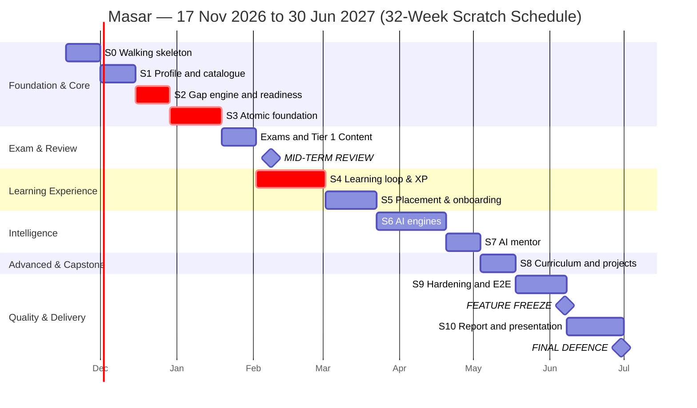

# 08 — Plan & Timeline

**Document owner:** Abdelrahman Megahed · **Status:** Revised <2026-11-17> (Re-baselined from scratch to 30 June 2027)

**Start:** Tue 17 Nov 2026 · **Mid-term review:** Mon 8 Feb 2027 (Week 12) ·
**Feature freeze:** Mon 7 Jun 2027 (Week 29) · **Final defence:** Wed 30 Jun 2027 (Week 32) · **32 weeks total**

---

## 0. Re-baseline: Starting from Scratch (17 Nov 2026 to 30 June 2027)

As of **Tuesday 17 November 2026**, the Masar engineering project timeline has been re-baselined from scratch to span **32 calendar weeks (225 days)** through to the university graduation defense on **Wednesday 30 June 2027**.

All vertical slices begin anew from **S0 (Walking Skeleton)**, incorporating the Atomic Roadmap architecture ([ADR-0007](adr/0007-atomic-roadmap.md)), offline content authoring pipeline ([ADR-0008](adr/0008-content-authoring-pipeline.md)), gamification ethics ([ADR-0009](adr/0009-gamification-and-engagement-ethics.md)), and client-side lesson evaluation with authoritative backend re-grading ([ADR-0010](adr/0010-lesson-grading-authority-and-content-delivery.md)).

---

## 1. Core Planning Principles

1. **Vertical slices, not horizontal layers.** Every slice below is **independently demonstrable end-to-end**, integrating frontend UI, backend domain logic, and persistence so integration risk is paid down continuously.
2. **Fixed defence deadline.** The project works backwards from the Faculty of Computers and Informatics final defense deadline on **Wednesday 30 June 2027**.
3. **Rigorous buffer discipline.** A strict feature freeze takes effect on **Sunday 7 June 2027 (Week 29)**, reserving a dedicated **23-calendar-day ($\approx 3.3$-week) stabilization buffer** exclusively for end-to-end testing, empirical evaluations (RQ1–RQ8), thesis documentation, and rehearsal.

---

## 2. Priority Matrix — Single Source of Truth

| Feature | Tier | Owner | Depends on | Demo-critical | Fallback if it fails |
|---|---|---|---|:-:|---|
| **Skill-Gap Analysis** | 🔴 Core | Osama | Profile, Career DB | **Yes** | None — pure computation |
| **Atomic Roadmap & Lesson Loop** | 🔴 Core | Osama · Ziad | Atom graph, prereqs | **Yes** | None — pure computation |
| Lesson Player | 🔴 Core | Ziad · Mazen | Static bundles | **Yes** | Simplified question runner |
| Student Profile | 🟡 MVP | Mohamed Y. | Skill catalogue | Yes | — |
| Onboarding Wizard | 🟡 MVP | Mazen | Assessment, Profile | Yes | Direct profile entry (F-06) |
| Career & Skill Database | 🟡 MVP | Mohamed Y. | Seed data | Yes | Hand-curated O\*NET/ESCO |
| Career Recommendation (AI model) | 🟡 MVP | Ahmed Y. | Profile, FastAPI Svc | Yes | FastAPI deterministic fallback |
| Deterministic Recommendation Baseline | 🟡 MVP *(eval/fallback)* | Ahmed Y. | RQ1 comparison | No | FastAPI deterministic fallback |
| Career Assessment (22 items) | 🟡 MVP | Mohamed Y. | — | Yes | — |
| Mastery Derivation & Readiness | 🟡 MVP | Osama | Atom states | **Yes** | None — deterministic view |
| XP, Streak & Weekly Goal | 🟡 MVP | Osama · Mazen | Lessons, Timezone | **Yes** | Local daily counters |
| Content Factory Pipeline | 🟡 MVP *(offline)* | Mohamed Salah · Ahmed Y. | Dev LLM quota | No | Human outlines & reduced careers |
| Job-Skill Extraction | 🟡 MVP *(offline)* | Ahmed Y. | Job corpus | No | Alias dictionary + taxonomy |
| Learning Resources (Deep dives) | 🟡 MVP | Mohamed Y. | Curated seed | Yes | — |
| Stage Project Nodes | 🟡 MVP | Mohamed Y. | Gaps, projects | Yes | — |
| Admin Content Panel | 🟡 MVP | Mohamed Y. · Mohamed Salah | Admin role | No | Direct SQL |
| Demo Mode | 🟡 MVP | Mohamed Salah | Fixtures | **Yes** | — |
| Adaptive Placement & Checkpoints | 🔵 Should | Mohamed Y. · Mazen | Exercises | No | Self-report only, unverified |
| Spaced Review Queue (Leitner) | 🔵 Should | Osama · Ziad | Learned atoms | No | Chronological practice |
| Exam-Week Streak Pause (14 days) | 🔵 Should | Osama | Student game state | No | Manual streak freezes |
| AI Mentor (Atom retrieval) | 🔵 Should | Ahmed Y. · Ziad | Atom vectors, LLM | No | Stored exercise explanations |
| Curriculum-to-Atom Mapping | 🔵 Should | Mohamed Y. | Course catalogue | No | Reduced course subset |
| Internship Readiness Checklist | 🔵 Should | Mohamed Y. | Project nodes | No | — |
| Advisor Atom Analytics | 🔵 Should | Osama | Student atom states | No | — |
| What-If Target Comparison | 🔵 Should | Osama | Gap engine | No | — |
| Explainability Panel | 🔵 Should | Ziad | Domain calculators | No | — |
| Achievements & Quests | ⚪ Later/Could | Mazen · Yousef K. | Game state | No | Cut first |
| Weekly Leagues (Opt-in) | ⚪ Later/Could | Mazen | XP totals | No | Cut first |
| Evidence on skill claims | ⚪ Later | — | Portfolio items | No | — |
| Mobile App (Native) | ⚪ Later | — | API | No | Responsive PWA |

---

## 3. Slice Plan (32 Weeks: 17 Nov 2026 – 30 Jun 2027)

| Slice | Weeks | Dates | Core Deliverables | Status |
|---|---|---|---|---|
| **S0 Walking skeleton** | W1–W2 | 17 Nov – 30 Nov 2026 | Multi-service Docker compose (Postgres + pgvector, .NET 10 API, FastAPI AI, React 19 SPA); CI/CD workflows; base auth (JWT); initial OpenAPI contract frozen | In progress |
| **S1 Profile & catalogue** | W3–W4 | 1 Dec – 14 Dec 2026 | 60 skills seeded from O\*NET/ESCO with aliases, category hierarchy, prerequisite DAG v1; student profile CRUD, academic history, student consent disclosure; 22-item assessment | Scheduled |
| **S2 Gap engine & readiness** | W5–W6 | 15 Dec – 28 Dec 2026 | 6 careers seeded with importance weights; `GapCalculator` and `ReadinessCalculator`; gap UI with severity badges; demo mode with offline fixtures | Scheduled |
| **S3 Atomic foundation** | W7–W9 | 29 Dec 2026 – 18 Jan 2027 | Atom/Unit/Path schema & migrations; CI validator; `PathBuilder` and `MasteryCalculator`; **API v2 contract frozen at end of W9**; lesson player prototype with 3 exercise types on pilot unit (`sql-fundamentals`, ~150 atoms); content factory v1 | Scheduled |
| ⏸ **Exam block & Content Review** | W10–W11 | 19 Jan – 1 Feb 2027 | Mid-year university exam window (capacity ~40%); asynchronous human peer review of drafts; **Tier 1 Content Complete (~1,000 atoms: Foundations + Backend .NET)** | Scheduled |
| 🎯 **Milestone: Mid-Term Review** | W12 | **Mon 8 Feb 2027** | Demonstrate atomic roadmap, gap analysis, and interactive lesson player to supervisor (Dr. Hend) | Scheduled |
| **S4 Learning loop** | W12–W15 | 2 Feb – 1 Mar 2027 | Lesson API (`POST /api/lessons/{sessionId}/complete`) with authoritative server re-grading and idempotency; XP, streak, weekly study goal; smooth continuous readiness; path UI with virtualisation; static bundle publishing | Scheduled |
| **S5 Placement & onboarding** | W16–W18 | 2 Mar – 22 Mar 2027 | 5-step onboarding wizard complete with adaptive placement and weekly study goal; unit checkpoints (8 questions, $\ge 75\%$ pass boundary, +50 XP); 5-box Leitner review queue (Practice tab) | Scheduled |
| **S6 AI engines** | W19–W22 | 23 Mar – 19 Apr 2027 | Job extraction layers 1–4 ([RQ2](09-evaluation.md#rq2)); corpus importance weights; sentence embeddings (`all-MiniLM-L6-v2`); model-first career recommendation + [RQ1](09-evaluation.md#rq1) measurement; **Tier 2 Content Complete (~2,200 atoms)** | Scheduled |
| **S7 AI mentor** | W23–W24 | 20 Apr – 3 May 2027 | Sanitised Context DTO, RAG with atom retrieval, prompt injection hardening, stored explanations fallback, mentor grounding audit ([RQ4](09-evaluation.md#rq4)) | Scheduled |
| **S8 Curriculum, projects & advisor** | W25–W26 | 4 May – 17 May 2027 | Suez Canal curriculum-to-atom mapping; Stage Capstone Project nodes (+100 XP); internship checklist; advisor atom analytics ($k \ge 5$ suppression); what-if comparison; **Tier 3 Content Complete (~4,050 atoms)** | Scheduled |
| **S9 Hardening & Evaluation** | W27–W29 | 18 May – 7 Jun 2027 | **Content Freeze Mon 24 May 2027**; E2E tests per user story; accessibility audit (WCAG 2.1 AA); load test (100 concurrent students); security review; usability studies ([RQ5](09-evaluation.md#rq5), [RQ8](09-evaluation.md#rq8)); **Feature freeze Mon 7 Jun 2027** | Scheduled |
| **S10 Report & defence** | W30–W32 | 8 Jun – 30 Jun 2027 | Comprehensive thesis report draft, evaluation data scripts ([RQ1](09-evaluation.md#rq1)–[RQ8](09-evaluation.md#rq8)), slide deck, full dress rehearsal, **Final Defence on Wed 30 Jun 2027** | Scheduled |

---

## 4. Timeline Overview

---

## 5. Key Milestones

| Milestone | Date | Week | Definition of done |
|---|---|:-:|---|
| **Walking skeleton** | 30 Nov 2026 | 2 | Staging deploy, 3 services communicating, baseline API contract |
| **Core value loop** | 28 Dec 2026 | 6 | Gap analysis and baseline readiness score working live |
| **API v2 contract freeze** | 18 Jan 2027 | 9 | v2.0.0 OpenAPI spec frozen for atomic roadmap and lesson player |
| **Tier 1 Content (~1,000 atoms)** | 1 Feb 2027 | 11 | Shared foundations + Backend (.NET) atoms reviewed & published |
| **Mid-term review** | **8 Feb 2027** | **12** | Demonstrated atomic roadmap and lesson player live to supervisor |
| **Full learning loop** | 1 Mar 2027 | 15 | Lesson player, re-grading, XP, streak, weekly goal, static bundles |
| **Tier 2 Content (~2,200 atoms)** | 19 Apr 2027 | 22 | Frontend/Full-Stack and Data Engineering atoms completed |
| **Intelligence integrated** | 3 May 2027 | 24 | Extraction, embeddings, model-first recommendation, mentor with retrieval |
| **Tier 3 Content (~4,050 atoms)**| 17 May 2027 | 26 | Full curriculum atoms across all 6 careers completed |
| **Content freeze** | **24 May 2027** | **27** | Content authoring locked; QA and bug fixes only |
| **Feature freeze** | **7 Jun 2027** | **29** | Code complete; ≈ 3.3 weeks (23 days) margin before defence |
| **Report submitted** | 23 Jun 2027 | 31 | Final graduation thesis documentation delivered |
| **Final defence** | **30 Jun 2027** | **32** | Formal university graduation project defense |

---

## 6. Definition of Done

- [ ] Code merged to `main` via reviewed PR ($\le 400$ lines).
- [ ] Unit tests for Domain calculators; integration tests for API endpoints.
- [ ] Every acceptance criterion of the linked user story verified.
- [ ] Authorization enforced: another student's data provably inaccessible (HTTP 404).
- [ ] Deployed to staging and exercised live.
- [ ] No new lint or compiler warnings.
- [ ] Full keyboard navigation and accessible labels (no color-only status).
- [ ] Loading, empty, and cold-start states implemented.

---

## 7. RACI by Workstream

**R**esponsible · **A**ccountable · **C**onsulted

| Workstream | R | A | C |
|---|---|---|---|
| Architecture & integration | Abdelrahman | Abdelrahman | All |
| API contract v2.0.0 | Abdelrahman | Abdelrahman | Mohamed Y., Ziad, Osama |
| Atom/Unit/Path schema & migrations | Mohamed Yasser | Mohamed Yasser | Osama, Abdelrahman |
| **Path engine, mastery, game domain & lesson API** | **Osama** | Osama | Mohamed Y., Abdelrahman |
| Content factory tooling, CI validator, publishing, uptime ping | **Mohamed Salah** | Mohamed Salah | Ahmed Y., Osama |
| Curriculum-to-atom mapping | Mohamed Yasser | Mohamed Yasser | Mazen, Dr. Hend |
| AI recommendation, extraction, evaluation scripts | Ahmed Yousef | Ahmed Yousef | Ziad, Abdelrahman |
| AI mentor (RAG with atom retrieval) | Ahmed Yousef | Ahmed Yousef | Ziad, Abdelrahman |
| Lesson player UI & path virtualisation | Ziad, Mazen | Ziad | Yousef K. |
| Design tokens, accessible UI components, animations | Yousef Khaled | Yousef Khaled | Ziad, Mazen |
| Usability studies (RQ5, RQ8) | Yousef Khaled | Yousef Khaled | Ahmed Y., Dr. Hend |
| CI/CD & infrastructure hosting | Mohamed Salah | Mohamed Salah | Abdelrahman |
| Security review & authorization | Abdelrahman | Abdelrahman | Mohamed Y., Mohamed Salah |
| Final report & defence presentation | Abdelrahman | Abdelrahman | All, Dr. Hend |

Abdelrahman appears in 8 rows across architectural integration, contract governance, security review, and defence coordination.

---

## 8. Working Agreements

- Branch naming: `feat/s0-walking-skeleton`, `fix/streak-timezone`, `docs/api-v2`.
- Async standups twice weekly; team demo weekly; fortnightly supervisor briefings.
- Escalation: Any blocking issue lasting $> 24$ hours is escalated directly to Abdelrahman.

---

## 9. Contingency Plan

If a slice overruns its time budget, features are cut in this strict priority order:

1. Leagues and quests (Could)
2. Explainability panel breadth (limit to gap table only)
3. What-if career preview
4. Advisor atom-level analytics
5. Internship readiness checklist
6. Curriculum mapping (cut only under severe schedule pressure)
7. Spaced review queue (fall back to chronological practice)
8. AI mentor (fall back to stored exercise explanations)
9. Adaptive placement probe (rely on unit checkpoints only)

**Never cut:** Skill-gap analysis, atomic roadmap + lesson loop, readiness score, XP/streak game state, demo mode.

---

**Next:** [09 — Evaluation](09-evaluation.md)
