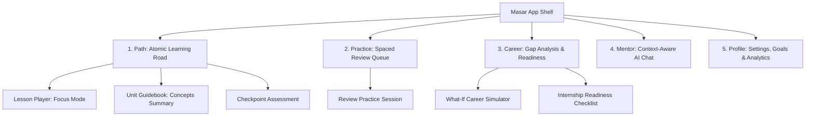
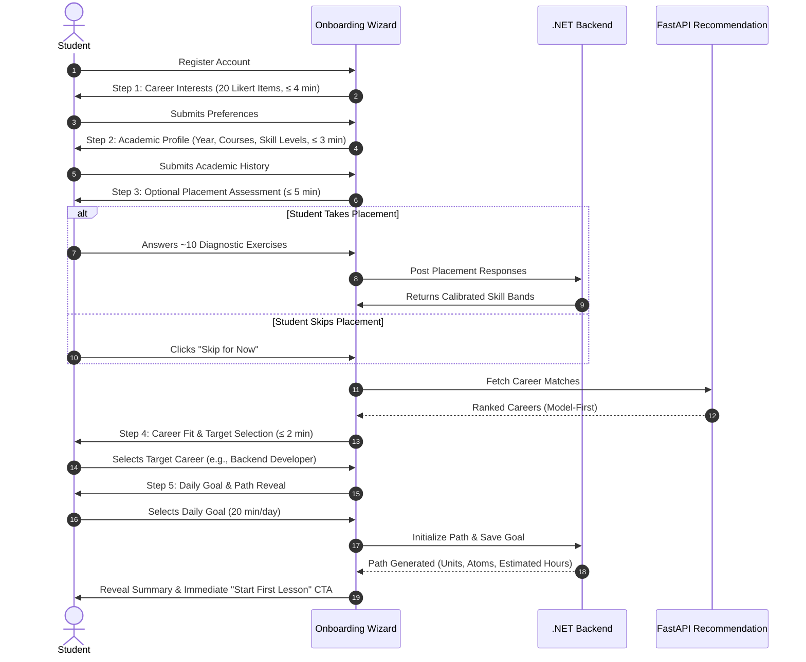

# 13 — Learning Experience Specification

**Document owner:** Yousef Khaled · **Contributors:** Mazen, Ziad, Abdelrahman · **Status: Created <2026-11-15> (atomic roadmap revision)**

---

## 1. Design Principles

Masar is an academic career navigation and mastery platform built specifically for Egyptian computer science students. The learning interface adapts modern, evidence-backed micro-learning interaction patterns (bite-sized lessons, clear visual progression, immediate feedback, and positive daily habit formation) while adhering strictly to academic integrity and ethical software engineering.

### Core Principles

1. **Original Identity & Voice:** Masar develops its own visual identity, bespoke color palette, and original mascot character (designed by Yousef Khaled; see [OD-3](15-open-decisions.md#od-3)). Under no circumstances does Masar copy, mimic, or reference third-party commercial mascots, trademarks, trademarked sounds, or proprietary trade dress (e.g., Duolingo's owl or green palette). The platform name, tone, and visual elements stand entirely on their own.
2. **Formative, Never Punitive:** Learning software engineering requires experimentation, hypothesis testing, and learning from syntax and logical errors. The system never locks students out, imposes cooldown delays, or uses punitive "hearts" or "lives" mechanics. Mistakes are treated as essential learning signals, immediately answered with clear explanatory feedback and re-queued for practice.
3. **Respect Learner Time and Cognitive Load:** Micro-lessons are scoped to 3–8 minutes. Screens are free of visual clutter, promotional banners, or unnecessary animations. The UI emphasizes clarity, readability of code, and single-task focus.
4. **Transparent Mastery:** Progression is never an arbitrary score. Every step along the path is mathematically linked to an underlying skill graph and verifiable competence, visibly advancing continuous career readiness.
5. **Universal Accessibility:** Accessibility is not an afterthought. Joyful interactions and celebration animations must not compromise usability for students with motor, cognitive, visual, or vestibular impairments.

---

## 2. Information Architecture

Masar adopts a mobile-first, responsive information architecture. The primary navigation is structured around five core views accessible via a persistent bottom navigation bar on mobile and a streamlined left-hand sidebar on tablet and desktop viewports.



### Primary Views

1. **Path (`/path`):** The primary daily home screen. Displays the vertical winding roadmap of learning units, active and locked atoms, stage checkpoints, and milestone projects.
2. **Practice (`/practice`):** Dedicated spaced-repetition hub. Houses the 3-box Leitner review queue, showing atoms due for review, shaky concepts needing reinforcement, and completed review statistics.
3. **Career (`/career`):** Comprehensive career analytics. Contains the detailed skill gap table, continuous readiness percentage trend, "What-If" career explorer, and internship readiness checklist.
4. **Mentor (`/mentor`):** Retrieval-augmented AI conversational mentor. Grounded exclusively in the student's profile, active gaps, and authored learning atoms with deep-linking back to specific lessons.
5. **Profile (`/profile`):** Personal dashboard, streak calendar, daily study goal settings, notification preferences, account management, and privacy disclosures.

### Desktop Responsive Adaptations

On desktop viewports ($\ge 1024\text{ px}$), the screen expands into a high-productivity three-column layout:

- **Left Column (240 px):** Persistent brand header, navigation menu, and quick profile switcher.
- **Center Column (Fluid, max 720 px):** The primary view content (Path, Practice, Career, or Mentor).
- **Right Companion Panel (320 px):** Always-visible daily summary card containing:
  - Daily goal ring (e.g., 14/20 minutes completed today).
  - Current streak counter with freeze shields and freeze status.
  - Overall career readiness mini-gauge and delta over the last 7 days.
  - Reviews due today badge (with instant "Review Now" trigger).

---

## 3. Path Screen Specification

The Path screen represents the curriculum as a vertical, winding river of interactive nodes organized into discrete thematic Units.

```text
+-------------------------------------------------------------------+
|  [Streak: 12 🔥]   [XP: 1,450 ⚡]   [Backend: 68% 🎯]   [(20m) ⭕] |
+-------------------------------------------------------------------+
|                                                                   |
|   =================== UNIT 1: RELATIONAL MODELING =============   |
|   [Progress: 4/8 Atoms]  [📖 Guidebook]  [⚡ Test Out Checkpoint] |
|   =============================================================   |
|                                                                   |
|                             ( * )  1.1 Tables & Keys (Learned)    |
|                            /                                      |
|                          ( * )    1.2 Primary vs Foreign (Learned)|
|                            \                                      |
|                             (▶)   1.3 One-to-Many Relationships   |
|                            /      +-----------------------------+ |
|                           |       |  [ START LESSON (+15 XP) ]  | |
|                           |       +-----------------------------+ |
|                         (   )     1.4 Many-to-Many & Joins (Lock) |
|                           \                                       |
|                            (   )  1.5 Normalization 1NF-3NF (Lock)|
|                             \                                     |
|                             [🏆]  Stage Checkpoint: SQL Basics    |
|                                                                   |
+-------------------------------------------------------------------+
```

### Visual Node Hierarchy and States

To comply with accessibility requirements (WCAG 2.1 SC 1.4.1), node states are **never conveyed by color alone**. Each state combines a distinct shape, icon, border, label, and accessible aria attributes:

| State | Icon / Glyphs | Visual Styling | Interaction | Aria Label |
|---|---|---|---|---|
| `learned` | Checkmark (`✓`) | Solid brand accent fill, solid border | Click opens review modal | "Completed atom: {title}. Mastery confirmed." |
| `assumed` | Double check (`✓✓`) | Soft muted tint, dotted border | Click shows placement bypass note | "Assumed known via placement: {title}." |
| `current` | Play arrow (`▶`) | Animated glowing border, pulsating start bubble | Click launches Lesson Player | "Current atom: {title}. Ready to start." |
| `available`| Open circle (`○`) | White/light background, high-contrast solid border | Click launches Lesson Player | "Available atom: {title}." |
| `shaky` | Alert dot (`!`) | Amber badge indicator, warning icon | Click prioritizes in review queue | "Needs review: {title}. Failed in recent session." |
| `locked` | Padlock (`🔒`) | Muted gray background, subtle outline | Click shows prerequisite tooltip | "Locked atom: {title}. Requires {prerequisites}." |

### Path Elements & Special Nodes

1. **Unit Banners:** Header separating curriculum units. Displays Unit Title, description, completed atom count, "Guidebook" button (opens a modal summarizing key syntax and mental models), and "Test Out" button (launches unit checkpoint).
2. **Current Atom Sticky Bubble:** A floating, high-visibility "START LESSON" callout pins directly adjacent to the student's active atom. Tapping anywhere on the active node or bubble launches the lesson immediately.
3. **Stage Checkpoints:** Distinct hexagonal shield nodes located at the terminus of major stages. Checkpoints test multiple concepts under time limits; passing with $\ge 80\%$ unlocks the next stage and awards +50 XP.
4. **Milestone Project Nodes:** Diamond-shaped nodes representing portfolio milestones (e.g., "Build a REST API with Auth"). Clicking opens the project brief, repository template, acceptance rubric, and submission modal.
5. **DOM Virtualization:** To guarantee 60 fps smooth scrolling on mobile devices across long roadmaps containing hundreds of nodes, the path view renders only the current unit plus two adjacent units above and below ($\pm 2$ units). Offscreen units are unmounted and replaced with placeholder spacer divs.

---

## 4. Lesson Player Specification

The Lesson Player is an immersive, distraction-free environment that maximizes focus during 3–8 minute study sessions.

### Layout and Screen Anatomy

```text
+-------------------------------------------------------------------+
|  [✕ Exit]  [====              Progress: 3/7              ====]    |
+-------------------------------------------------------------------+
|                                                                   |
|  QUESTION 3 OF 7 · RELATIONAL DATABASES                           |
|                                                                   |
|  Which constraint ensures that a foreign key in table `orders`    |
|  cannot reference a non-existent row in table `customers`?        |
|                                                                   |
|  [ 1 ]  UNIQUE constraint                                         |
|  [ 2 ]  CHECK (customer_id > 0)                                   |
|  [ 3 ]  FOREIGN KEY REFERENCES customers(id)                     |
|  [ 4 ]  NOT NULL constraint                                       |
|                                                                   |
+-------------------------------------------------------------------+
|  [ Bottom Action Bar: CHECK ANSWER (Enter) ]                      |
+-------------------------------------------------------------------+
```

### Exercise Types Supported

1. **Multiple Choice (Single & Multi-Select):** Clear question stem, code formatting blocks where applicable, 3–4 distinct options with keyboard shortcuts (`1`, `2`, `3`, `4`).
2. **Code Blank Fill-In:** Short snippet with an inline `<input>` field or token drop target (e.g., `SELECT * FROM users ___ age > 21;` with choice chip `WHERE`).
3. **Parsons Problems (Code Reordering):** 4–6 lines of jumbled code that the student reorders into syntactically and logically correct sequence. Fully operable via drag-and-drop as well as accessible "Move Up" / "Move Down" arrow buttons.
4. **Code Syntax Debugger / Spot the Defect:** A 4–8 line code snippet where the student clicks on the specific line containing a syntax or logical defect.

### Interaction Flow & Result Sheets

1. **Focus Mode:** Navigation bars and distraction elements are completely hidden. Tapping `✕ Exit` opens a non-punitive confirmation dialog ("Leave lesson? Your progress on this atom will not be saved").
2. **Immediate Local Grading:** Upon clicking `Check Answer` (or pressing `Enter`), the browser evaluates the response in memory against the pre-loaded unit bundle in < 50 ms.
3. **Sliding Result Sheet:** A bottom sheet animates into view:
   - **Correct:** Vibrant green accent card with checkmark icon, bold "Excellent!" or "Spot on!", short explanatory snippet explaining *why* it is correct, and a primary `Continue` button.
   - **Incorrect:** Soft terracotta/crimson accent card with alert icon, honest "Not quite" heading, detailed explanation identifying the misconception, and a "Report Problem" flag button.
4. **Mistake Re-Queue Loop:** Incorrectly answered exercises are **never failed permanently**. The failed item is returned to the bottom of the active session queue. The lesson cannot conclude until every exercise is correctly solved.
5. **Live Region Announcements:** Result states are coupled to an `aria-live="assertive"` container so screen readers immediately announce evaluation outcomes ("Correct. Next exercise ready" or "Incorrect. Explanation: ...").

### Lesson Completion Screen

Upon finishing the final exercise, the player transitions to a celebration summary:

- **XP Earned Card:** Base XP (+15 XP) plus First-Try Accuracy Bonus (+5 XP if $\ge 80\%$ correct on first pass).
- **Streak Status:** Flame counter incrementing with animated celebration ring.
- **Readiness Impact:** Real-time continuous readiness update: *"Backend Readiness: 64.2% $\to$ 64.6% (+0.4%)"*.
- **Review Schedule:** Next scheduled review appearance displayed: *"Added to Spaced Review: Due in 3 days"*.
- **Primary CTA:** "Continue Path" button navigating back to the updated roadmap with the next atom highlighted.

---

## 5. Reworked Onboarding Flow

The onboarding sequence guides new students from initial registration to their very first micro-lesson within a single cohesive, encouraging flow. It preserves the established 5-step model (FR-00) while integrating optional placement and daily habit commitments.



### Onboarding Steps Detail

- **Step 1: Technical Interests & Preferences ($\le 4\text{ min}$):** 20 Likert-scale statements probing work style, problem domains, and technical interests.
- **Step 2: Academic Background & Self-Placement ($\le 3\text{ min}$):** University year, completed SCU CS curriculum courses (pre-filling known foundational skills), and initial 0–5 ratings for core technologies.
- **Step 3: Optional Diagnostic Placement ($\le 5\text{ min}$):** Students can choose to prove prior competence across 2–3 claimed skills by answering 6–10 diagnostic questions drawn directly from authored atom probe pools. Students who skip start at Level 0 without penalty.
- **Step 4: Career Match & Target Selection ($\le 2\text{ min}$):** Presents the top recommended career matches generated by the model-first pipeline. The student reviews match scores and selects their target career.
- **Step 5: Daily Commitment & Path Reveal ($\le 1\text{ min}$):** Student selects their daily practice commitment (10, 20, 30, 45, or 60 min; default: 20 min). The screen reveals their personalized roadmap:
  > *"Your Path to Backend Developer: 7 Units · 412 Lessons · ~48 Hours of Practice. At 20 minutes/day, you will reach market readiness by March 2027."*
- **Immediate First Action:** The summary card features a prominent "Start First Lesson" button. Tapping it drops the student straight into their first 3-minute lesson, satisfying NFR-04:
  - **First lesson started $\le 10\text{ min}$ unaided** (placement skipped).
  - **First lesson started $\le 15\text{ min}$** (placement completed).

---

## 6. Gamification and Engagement Rules

Gamification in Masar exists to support intrinsic motivation, consistent daily habit formation, and long-term memory retention.

### Experience Points (XP) Economy

XP reflects focused practice time and active cognitive effort. XP has no monetary value, cannot be traded, and is never deducted.

| Action | XP Awarded | Criteria / Rules |
|---|---|---|
| **Atom Lesson Completed** | +15 XP | Standard reward upon finishing all exercises in an atom. |
| **First-Pass Bonus** | +5 XP | Awarded if all exercises in the lesson were answered correctly on first attempt. |
| **Spaced Review Completed** | +10 XP | Awarded for completing a scheduled review card session in the Practice tab. |
| **Unit Checkpoint Passed** | +50 XP | Awarded for scoring $\ge 80\%$ on an authoritative stage checkpoint. |
| **Milestone Project Submitted**| +100 XP | Awarded upon submitting an accepted portfolio milestone project. |

### Daily Goals, Streaks, and Timezones

1. **Daily Goal Threshold:** Students select a daily study target: 10 min (15 XP), 20 min (30 XP, default), 30 min (45 XP), 45 min (60 XP), or 60 min (80 XP).
2. **Streak Counter:** A streak represents consecutive calendar days where the daily XP threshold was satisfied.
3. **Timezone Authority:** All streak boundaries are evaluated against the student's configured IANA timezone (e.g., `Africa/Cairo`). Midnight in the student's local timezone defines the day cutoff, eliminating daylight savings bugs and server-time discrepancies.
4. **Streak Protections (Freezes):**
   - Students can equip up to **2 Streak Freezes** simultaneously.
   - Streak Freezes are earned naturally through 7-day streak milestones (never purchased with real money).
   - If a student misses a day, a Streak Freeze is consumed automatically, preserving the streak counter and notifying the student gently.
5. **Exam-Week Pause Flow:** Students can pause their streak for up to 21 consecutive days during official university examination periods. Pausing locks the streak without penalty and halts automated reminder emails.

### Copy Tone and Voice Guide

Masar communicates with students as a supportive, knowledgeable academic mentor.

| Scenario | ❌ Prohibited Dark-Pattern Copy | ✅ Approved Masar Copy |
|---|---|---|
| **Missed a Day** | *"You lost your streak! You made your mentor sad."* | *"Welcome back! Pick up where you left off with a quick 3-minute lesson."* |
| **Wrong Answer** | *"Wrong! You lost a life. 4 lives remaining."* | *"Not quite. Notice how the index order affects the composite lookup. Let's try it again."* |
| **Exam Alert** | *"Don't abandon your career! Practice now!"* | *"Midterms this week? You can pause your study streak in settings anytime."* |

---

## 7. Accessibility Architecture (WCAG 2.1 AA)

Masar's playful aesthetic is engineered strictly within the bounds of W3C Web Content Accessibility Guidelines (WCAG) 2.1 Level AA.

### Contrast and Color Discipline

- **Color Contrast Ratios:** All body text and code snippets maintain a minimum contrast ratio of **4.5:1** against backgrounds; large headers and active UI controls maintain at least **3.0:1** (SC 1.4.3).
- **Light Success Palette Contrast:** Standard bright gamified greens (`#00FF00`, `#22C55E`) fail contrast tests when paired with white text. Masar specifies high-contrast accessible variants (e.g., Forest Jade `#15803D` on white, or deep slate text `#0F172A` on mint background `#86EFAC`).
- **No Color-Only Signaling (SC 1.4.1):** Every status, validation state, and difficulty level combines color with text labels, icons, or geometric patterns.

### Motion, Vestibular Safety, and Audio

- **Vestibular Safety (SC 2.3.1 & SC 2.3.3):** Celebratory confetti, winding path transitions, and bouncy level-up animations are fully disabled when the user has enabled the operating system's `prefers-reduced-motion` setting. Reduced motion mode replaces motion with smooth instant fades.
- **Flashing Thresholds (SC 2.3.1):** No screen element, progress bar, or celebration effect flashes or strobes faster than 3 times per second.
- **Audio Defaults:** Sound effects (chimes, clicks) are **muted by default**. Audio can be enabled optionally in preferences and is never used as the sole indicator of an event.

### Keyboard and Screen Reader Support

- **Keyboard Traversal:** The entire Lesson Player is 100% keyboard-navigable. Number keys (`1`–`4`) select multiple-choice items, `Space` toggles checkboxes, `ArrowUp`/`ArrowDown` reorder Parsons lines, and `Enter` triggers Check/Continue.
- **Bilingual & RTL Support:** Masar's layout supports bidirectional rendering. In Arabic mode, navigation and prose flow Right-to-Left (RTL), while code blocks, SQL queries, and terminal commands remain isolated Left-to-Right (LTR) islands.
- **Accessible Chart Equivalents:** All graphical career gap charts and readiness progress wheels provide direct tabular or textual equivalents for screen reader users.

---

## 8. State Handling: Empty, Loading, and Error States

Robust user experience requires graceful, helpful interface states across unreliable network conditions.

1. **Backend Cold Starts:** When waking up sleeping free-tier backend services, the UI displays a branded animated pulse with transparent copy:
   > *"Waking up Masar services... This takes about 20 seconds on our free-tier hosting. Your lesson content is already loaded!"*
2. **Network Disconnection / Offline Mode:** If network connectivity drops during a lesson, the Lesson Player continues uninterrupted using the pre-cached static unit bundle. An unobtrusive banner indicates: *"Offline: answers will sync when connection is restored."* Attempt submissions are queued in `localStorage` and dispatched automatically upon reconnection.
3. **No Due Reviews (Zero State):** When a student opens the Practice tab with zero pending reviews, the UI displays a cheerful illustration:
   > *"All caught up! Your memory banks are fully charged. Return tomorrow or practice ahead on your active Path."*
4. **Content-Limited Career Warning:** If a student selects a career track with partial content coverage (e.g., Tier 2 or 3 tracks during early rollout), a banner explains:
   > *"Foundations and Core units are fully active. Advanced specialization lessons for this career are currently being reviewed by faculty."*

---

## 9. Privacy-Preserving Telemetry

To support empirical evaluation of Masar's educational effectiveness ([RQ7 & RQ8](09-evaluation.md#rq7)), the platform captures anonymized, privacy-minimal learning telemetry.

### Telemetry Events Captured

- `lesson_started`: `{ atom_id, timestamp, entry_point }`
- `exercise_evaluated`: `{ exercise_id, attempt_number, duration_ms, is_correct, mistake_type }`
- `lesson_completed`: `{ atom_id, total_duration_seconds, score_percent, xp_awarded }`
- `review_card_answered`: `{ atom_id, leitner_box_from, leitner_box_to, latency_ms }`

### Privacy Constraints

- **Zero Free-Text Capture:** Telemetry streams never capture student chat messages, free-form notes, or personally identifiable information.
- **Aggregated Analytics:** Student logs are analyzed in aggregate for psychometric item analysis (identifying ambiguous exercises or unexpected failure spikes).
- **Advisor Suppression:** Advisor cohort dashboards suppress analytics for any atom or unit with fewer than 5 student attempts ($k \ge 5$) to prevent deanonymization.

---

## 10. Design-System Deliverables for Yousef Khaled

To support frontend implementation in Slice 3 and Slice 4, the following design assets and specifications are assigned to lead designer Yousef Khaled:

1. **Token System (Tailwind CSS):**
   - Palette: Primary Brand (Navy/Teal), Accent (Amber/Gold), Surface neutrals, and WCAG-compliant semantic states (Success Forest, Error Crimson, Warning Ochre).
   - Typography: Clean sans-serif hierarchy optimized for bilingual Latin/Arabic legibility (e.g., Inter + Cairo or IBM Plex Sans Arabic). Monospace pairing for code snippets (JetBrains Mono or Fira Code).
2. **Component Library:**
   - `PathNode`: Vector component rendering all 6 state variations with accessible icons.
   - `UnitBanner`: Responsive unit milestone card with guidebook trigger.
   - `ExerciseContainer`: Polymorphic container hosting Multiple Choice, Parsons, and Blank-Fill inputs.
   - `ResultSheet`: Animated, accessible bottom sheet with sound-effect hooks.
   - `StreakFlameWidget`: Animated streak counter with freeze indicators.
   - `ReadinessRing`: Circular SVG progress indicator displaying continuous readiness $c(s)$.
3. **Bespoke Mascot & Illustrations Plan:**
   - 4 emotional states for Masar's original mascot: Welcoming (Onboarding), Encouraging (Practice), Celebrating (Milestone/Checkpoints), and Thinking (Mentor).
   - Vector SVG format, fully optimized for lightweight CDN loading (< 30 KB per asset).

---

**Next:** [14 — Content Authoring Pipeline](14-content-pipeline.md)
