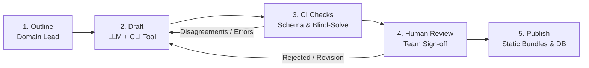
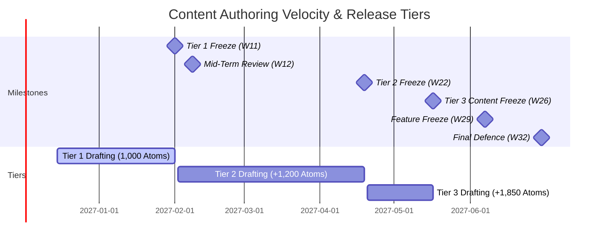

# 14 — Content Authoring and Quality Pipeline

**Document owner:** Osama · **Contributors:** Ahmed Yousef, Mohamed Yasser, Mohamed Salah, Mazen, Ziad · **Status: Created <2026-11-15> (atomic roadmap revision)**

---

## 1. Executive Summary & Reality Check

The adoption of the Atomic Roadmap ([ADR-0007](adr/0007-atomic-roadmap.md)) establishes a target corpus of approximately **4,050 micro-lessons (atoms)** across all six tracked technology tracks at Suez Canal University.

### The Reality Check

Hand-crafting 4,050 interactive micro-lessons—each complete with concise conceptual explanations, verified code examples, and 3–6 interactive exercises—requires approximately 20 minutes of authoring per atom. That equates to **1,350 person-hours** of writing. In a 35-week undergraduate capstone project already demanding substantial backend, frontend, AI, and evaluation engineering, manual authoring of this volume is mathematically impossible without catastrophic project failure.

Conversely, dynamically generating content at runtime via LLMs is equally unviable: it introduces unpredictable hallucinations, broken code, latency spikes (> 3s), and quickly exhausts free-tier API quotas.

**The Solution:** Masar implements a high-throughput **Offline Content Authoring Pipeline** combining LLM-assisted drafting with automated CI linting (schema validation, code execution, blind-solve validation, and link allowlisting) and mandatory human peer review. This reduces human effort from 20 minutes to approximately **4 minutes per atom** (review and refinement), making the production of 4,050 verified, high-quality atoms completely achievable across the remaining project timeline.

---

## 2. Five-Stage Pipeline Architecture

Every learning atom progresses through a rigorous 5-stage quality lifecycle before it can be delivered to students.

### Stage 1: Pedagogical Outline (Human-Authored)

- **Actor:** Domain Lead (assigned team member per career track).
- **Activity:** The domain lead creates a YAML unit outline specifying:
  - Skill and proficiency band (0–5).
  - Prerequisites within the skill DAG.
  - 4–8 granular atom objectives.
  - **Rule:** Each objective must state a single, atomic learning outcome (e.g., *"Construct an inner join between two tables with foreign key constraints"*). Objectives containing conjunctions (*"and"*, *"as well as"*) are rejected by policy.

### Stage 2: Assisted Drafting (`content-cli`)

- **Actor:** Offline authoring CLI (`tools/content-cli`), operated by team members.
- **Activity:** The CLI sends structured prompts to a developer-keyed LLM (utilizing dedicated development quota, completely isolated from runtime mentor quotas; see [ADR-0002](adr/0002-llm-provider.md) and [ADR-0008](adr/0008-content-authoring-pipeline.md)).
- **Batching:** Generates batches of 3–5 atoms per prompt.
- **Output Schema:** Produces raw JSON adhering strictly to `schemas/atom.draft.schema.json`:
  - `title`: $\le 60$ characters.
  - `summary`: $\le 150$ words.
  - `key_concepts`: 2–4 bulleted points.
  - `exercises`: 3–6 interactive items (multiple choice, parsons problems, syntax blanks), with at least 1 diagnostic placement probe per skill band.

### Stage 3: Automated CI Validation & Blind-Solve Testing

- **Actor:** Automated GitHub Actions runner (`.github/workflows/content-ci.yml`).
- **Validation Gates:**
  1. **Schema Integrity:** Strict JSON Schema validation against the canonical `Atom` entity specification.
  2. **Zero-Hallucination Link Policy:** All external URLs inside generated markdown text are **strictly rejected**. The CI scanner fails if any `http://` or `https://` string is present in student-facing text unless explicitly matched against a verified team allowlist of official documentation.
  3. **Code Execution Sandbox:** All code snippets contained in exercises are compiled and executed in an isolated CI container (e.g., C# / Python / SQL syntax verification).
  4. **The Blind-Solve Test:** An independent LLM prompt or programmatic solver attempts to solve each generated exercise *without access to the declared answer key*. While an automated threshold of $\ge 90\%$ blind-solve agreement is required for a batch to clear CI, **100% of individual dissenting exercises** where the blind solver disagreed with the declared key are automatically quarantined for mandatory human review and resolution before approval.
  5. **Semantic Deduplication:** New atom summaries are embedded via Sentence-Transformers (`all-MiniLM-L6-v2`) and compared against existing published atoms. Cosine similarity $\ge 0.90$ triggers a duplicate warning.
  6. **Profanity & Neutrality Filter:** Ensures inclusive, academically professional language.

### Stage 4: Human Peer Review & Sign-Off

- **Actor:** Dedicated Review Panel: 5 primary active reviewers (Osama Mohammed, Mohamed Yasser, Mazen Oraby, Yousef Khaled, Ziad Ahmed), supported by Abdelrahman Megahed and Ahmed Yousef for floating secondary sign-offs.
- **Review Budget:** ~4 minutes per atom (reviewing code, checking distractor plausibility, verifying explanations).
- **Review Checklist:**
  - [ ] Is the content technically accurate and current?
  - [ ] Is the scope truly atomic (single concept)?
  - [ ] Are the distractors plausible without being misleading trick questions?
  - [ ] Is the explanation encouraging, concise, and helpful?
  - [ ] Have all blind-solve discrepancies on this atom been manually inspected and resolved?
- **Dual-Review Rule:** All advanced **Level 4 and Level 5 atoms** require independent sign-off from **two team members** or supervisor spot-checking before approval.
- **State Transition:** `status` advances from `draft` $\to$ `reviewed` $\to$ `approved`.

### Stage 5: Bundle Compilation & Publication

- **Actor:** Automated Release Workflow.
- **Activity:** Approved atoms (`status: "approved"`) are compiled into immutable, hash-versioned static unit bundles (`/content/v{contentVersion}/units/{unitSlug}.{hash}.json`), published to the static CDN, and synced to production PostgreSQL.
- **State Transition:** `status` is set to `published`. Only `published` atoms are visible to students.

---

## 3. Provenance, Licensing, and Academic Integrity

Masar adheres strictly to academic integrity standards and intellectual property law:

1. **Explicit Provenance Metadata:** Every atom record stores permanent provenance attributes:
   - `authored_by`: Identity of author or drafting tool version.
   - `reviewed_by`: User ID of approving team reviewer(s).
   - `source: "ai-drafted-human-reviewed"`: Explicit transparency label.
   - `source_note`: Scholarly or authoritative reference cited for the concept (e.g., *"Based on PostgreSQL 16 documentation section 5.4"*).
2. **Original Expression:** Third-party course materials, proprietary question banks, or textbook text are **never copied** into Masar (NFR-15). All explanations and exercises are original formulations.
3. **Third-Party Curriculum Consultations:** Public roadmaps (e.g., `roadmap.sh`) and standard university curricula are consulted solely for broad topical taxonomy coverage, never for copied prose or code.

---

## 4. Content Phasing Tiers and Gating

Content production is phased across three discrete tiers aligned with the project development calendar:

### Production Tiers

| Tier | Target Date | Cumulative Atoms | Scope & Coverage | Operational Role |
|---|---|---|---|---|
| **Tier 1** | **W11** (1 Feb 2027) | **~1,000** | Shared Foundations (Git, OS, DB Basics) + Backend (.NET track full depth). | **Demo-Critical:** Powers end-to-end user testing and supervisor demonstration. |
| **Tier 2** | **W22** (19 Apr 2027) | **~2,200** | Adds Frontend/Full-Stack and Data Engineering at full depth. | **Evaluation Baseline:** Powers RQ1, RQ3, and initial cohort testing. |
| **Tier 3** | **W26** (17 May 2027) | **~4,050** | Expands AI/ML, DevOps, and Cybersecurity tracks across all bands. | **Full Catalogue:** Final content freeze prior to hardening and defense. |

### Throughput Arithmetic

- **Reviewer Allocation:** The review workload is distributed across **5 primary active reviewers** (Osama, Mohamed Yasser, Mazen, Yousef Khaled, and Ziad). Mohamed Salah is excluded as he operates Content Factory CLI and CI infrastructure; Ahmed Yousef operates AI generation and prompts; Abdelrahman provides floating integration capacity and dual-reviews Level 4–5 atoms.
- **Tier 1 (W4–W11 = 8 weeks active):** Requires $\approx 125\text{ atoms/week}$. Across 5 active reviewers, this equates to ~25 atoms/person/week ($\approx 1.7\text{ hours/week}$).
- **Tier 2 (W12–W22 = 11 weeks):** Requires $\approx 110\text{ atoms/week}$ (~22 atoms/person/week, $\approx 1.5\text{ hours/week}$).
- **Tier 3 (W23–W26 = 4 weeks):** Requires $\approx 460\text{ atoms/week}$ (~92 atoms/person/week, $\approx 6.1\text{ hours/week}$). All 7 team members participate during this final 4-week push to reduce per-person load to ~65 atoms/person/week ($\approx 4.3\text{ hours/week}$).

### Content Gating and Recommended Fallback

A career track is recommendable in production only when its active content satisfies the minimum publishable threshold ([F-23 constraint 2](06-ai-engines.md#32-candidate-filtering-and-mandatory-constraints)).

> [!IMPORTANT]
> **Contingency Rule (R-06 / OD-7):** If team throughput falls behind schedule at W23, Masar executes its documented fallback: **freeze full depth at 3 core careers (Backend, Frontend, Data Engineering)** and provide curated outline units for the remaining three. This maintains rigorous, defensible academic quality for the core tracks without risking project completion.

---

## 5. Team Workload Re-Balancing

To accommodate content pipeline operations alongside core software engineering, team responsibilities are re-balanced as follows:

| Team Member | Engineering Responsibilities | Content Pipeline Responsibilities |
|---|---|---|
| **Mohamed Salah** | DevOps, Hosting, Database Backups, Uptime | **Content Factory Lead:** Owns `tools/content-cli`, CI validator runner, static bundle publishing pipeline. |
| **Mohamed Yasser** | Backend Data Layer, EF Core, Schemas | **Schema & Taxonomy Lead:** Unit/Atom schemas, database migrations, curriculum-to-atom mapping loaders. |
| **Osama** | Domain Engines (Path, Mastery, Streak, Review) | **Curriculum Architect & Educational Review Lead:** Backend (.NET) domain outlines, path traversal algorithms, lesson submission endpoints, final educational review. |
| **Ziad** | Frontend Architecture, SPA Shell | **Lesson Experience Lead:** Lesson Player UI, Parsons problem component, bundle cache service. |
| **Mazen** | Frontend State, API Integration | **Reviewer & UI Contributor:** Onboarding flow, result sheets, Frontend track atom review. |
| **Yousef Khaled** | Design System, Accessibility (WCAG), Assets | **UX & Assets Lead:** Token library, bespoke mascot illustrations, accessible visual states. |
| **Ahmed Yousef** | AI Engines (FastAPI, MiniLM, RAG Mentor) | **AI Generation Lead:** LLM drafting prompt engineering, blind-solve test harness, mentor atom retrieval. |

### Exam Period Protocol (W10–W11)

During the university mid-year examination period from **W10–W11 (19 Jan – 1 Feb 2027)** (estimated 40% team engineering capacity), all heavy architectural coding is paused. Team members focus exclusively on asynchronous human peer review of pre-drafted batches, which can be performed in short, interruptible 20-minute sessions.

---

## 6. Continuous Quality and Post-Publication Analytics

The pipeline maintains a post-launch quality feedback loop driven by real student interaction telemetry:

1. **Student Flagging ("Report Problem"):** Students can flag confusing phrasing, ambiguous options, or potential typos directly from the Lesson Player. Flagged items enter an advisor triage queue.
2. **Psychometric Item Discrimination:** The system calculates the item difficulty index ($P$-value) and point-biserial discrimination coefficient for all exercise items. Exercises with extreme failure rates ($> 80\%$) or negative discrimination (where top-performing students fail more frequently than low performers) are automatically flagged for review.
3. **Cohort Bottleneck Reports:** Advisors review anonymized aggregations showing the top 5 most frequently failed atoms across cohorts ($k \ge 5$), identifying curricular concepts requiring faculty reinforcement.

---

**Next:** [15 — Open Decisions Log](15-open-decisions.md)
